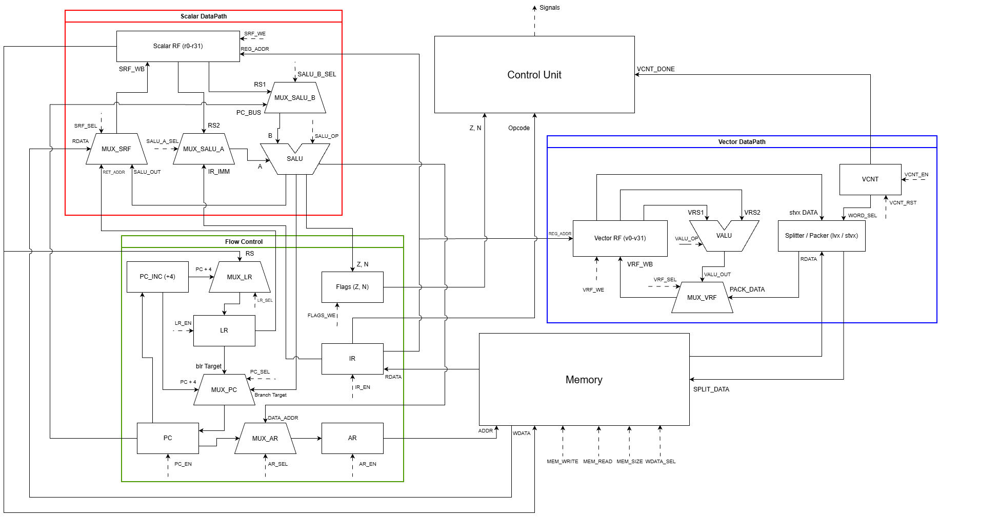
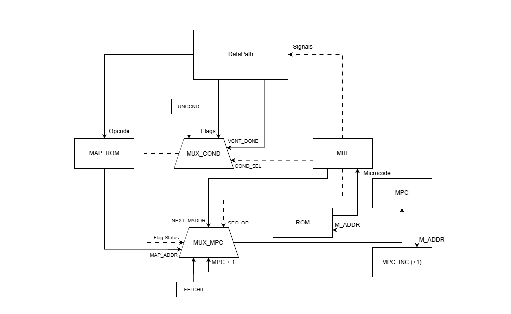
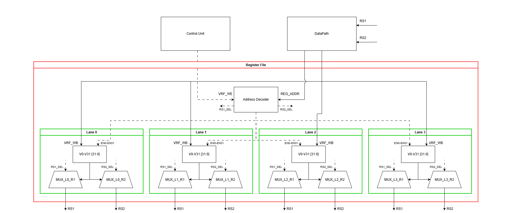

# Лабораторная работа №4. Эксперимент

* **Студент:** Валиуллин Даниил Равилевич
* **Группа:** P3231
* **Вариант:**
  ```text
  asm | risc | neum | mc | stream | mem | pstr | vector | alg2
  ```

---

## Язык программирования

Диалект языка ассемблера, стилизованный под архитектуру **PowerPC** с векторным расширением **AltiVec (VMX)**. Поддерживаются символьные метки, разделение на секции кода и данных, директива базового адреса `.org`, макросы препроцессора, а также экспорт и импорт символов для раздельной трансляции и компоновки.

### Синтаксис языка (БНФ)

```bnf
<program>            ::= { <line> }
<line>               ::= [ <label_decl> ] [ <statement> ] [ <comment> ] "\n"
<comment>            ::= ( "#" | ";" ) { <any_char> }
<label_decl>         ::= <identifier> ":"

<statement>          ::= <directive> | <instruction> | <macro_directive>

<directive>          ::= ".text"
                       | ".data"
                       | ".org" <number>
                       | ( ".global" | ".globl" ) <identifier>
                       | ".extern" <identifier>
                       | ".word" <num_list>
                       | ".byte" <num_list>
                       | ( ".pstr" | ".string" ) <string_literal>

<macro_directive>    ::= ( ".equ" | ".set" ) <identifier> [ <any_tokens> ]
                       | "%ifdef" <identifier> "\n" { <line> } "%endif"
                       | "%macro" <identifier> <integer> "\n" { <line> } "%endmacro"

<instruction>        ::= <mnemonic> [ <operand_list> ]
<operand_list>       ::= <operand> { "," <operand> }
<operand>            ::= <scalar_reg> | <vector_reg> | <mem_ref> | <immediate> | <identifier>

<scalar_reg>         ::= "r0" | "r1" | ... | "r31" | "sp" | "rtoc"
<vector_reg>         ::= "v0" | "v1" | ... | "v31"
<mem_ref>            ::= [ <immediate> | <identifier> ] "(" <scalar_reg> ")"

<immediate>          ::= [ "-" ] ( <decimal_number> | <hex_number> )
<decimal_number>     ::= <digit> { <digit> }
<hex_number>         ::= "0x" <hex_digit> { <hex_digit> }
<string_literal>     ::= '"' { <escape_sequence> | <any_char> } '"'
```

### Семантика и организация данных
* **Модель исполнения:** последовательное потактовое исполнение команд. Поток управления меняется только инструкциями ветвлений (`beq`, `bne`, `blt`, `bge`, `ble`, `bgt`), безусловного перехода (`b`), вызова подпрограмм (`bl`) и возврата (`blr`).
* **Области видимости:** метки по умолчанию локальны для единицы трансляции (файла). Директива `.globl` делает символ доступным линкеру для межмодульных связей. Директива `.extern` объявляет символ, определённый в другом модуле.
* **Секции:**
  * `.text` — исполняемые машинные инструкции.
  * `.data` — статические данные (массивы слов, байты, строки).
* **Формат строк (`pstr`):**
  * Строки Паскаля (Pascal Strings) начинаются с префикса длины размером в 1 байт.
  * Следом располагаются байты символов в кодировке ASCII.
* **Выравнивание:** все 32-битные инструкции и слова `.word` выравниваются по 4-байтовой границе (`address % 4 == 0`).

---

## Организация памяти

### Модель памяти
* **Архитектура:** Фон-Неймановская байт-адресуемая память единого адресного пространства (адреса `0x00000000`–`0xFFFFFFFF`).
* **Машинное слово:** 32 бита (4 байта).

### Регистры
* **Скалярный регистровый файл (GPR):** 32 регистра по 32 бита (`r0`–`r31`):
  * `r0` — аппаратный ноль при адресации памяти `0(r0)`; запись в него игнорируется.
  * `r1` (`sp`) — указатель вершины стека.
  * `r2` (`rtoc`) — указатель оглавления таблицы констант.
  * `r3`–`r12` — регистры общего назначения (в соглашении вызовов `r3` используется для первого аргумента и возврата значения).
  * `r13`–`r31` — регистры общего назначения / сохранённые регистры.
* **Векторный регистровый файл (AltiVec / VMX):** 31 регистр (`v0`–`v31`) по 128 бит:
  * Каждый векторный регистр разбит на **4 дорожки (lanes) по 32 бита** (SIMD $4 \times 32$).
* **Служебные регистры:**
  * `PC` (Program Counter) — 16 бит.
  * `AR` (Address Register) — 16 бит.
  * `IR` (Instruction Register) — 32 бита.
  * `LR` (Link Register) — 16 бит, независимый регистр связи для возврата из подпрограмм. Заполняется командой `bl` (`LR = PC + 4`), восстанавливается в `PC` командой `blr`. Перенос в скалярные регистры и обратно осуществляется инструкциями `mflr` и `mtlr`.
  * `Flags (Z, N)` — флаги состояния АЛУ: $Z$ (Zero), $N$ (Negative). Обновляются только инструкциями сравнения (`cmpw`, `cmplw`, `cmpwi`).

### Карта адресного пространства
```text
+-----------------------+ 0x00000000
| Секция кода (.text)   |
+-----------------------+
| Секция данных (.data) |
| - Pascal-строки       |
| - Массивы (.word)     |
+-----------------------+ 0xFFFF0000
| STDIN_DATA (R)        | Порт чтения потока ввода
+-----------------------+ 0xFFFF0004
| STDOUT_DATA (W)       | Порт записи потока вывода
+-----------------------+ 0xFFFF0008
| Стек (вниз)           | <--- r1 (sp)
+-----------------------+ 0xFFFFFFFF
```

---

## Система команд (ISA)

Все команды кодируются 32-битным словом фиксированной длины.

### Форматы команд

```text
1. R-type (Регистровые операции АЛУ):
   [31:26 opcode (6)] [25:22 rd (4)] [21:18 rs1 (4)] [17:14 rs2 (4)] [13:0 pad (14)]

2. I-type (Непосредственные операции / Память):
   [31:26 opcode (6)] [25:22 rd (4)] [21:18 rs1 (4)] [17:2 imm16 (16)] [1:0 pad (2)]

3. B-type (Условные переходы):
   [31:26 opcode (6)] [25:22 cond (4)] [21:18 rs1 (4)] [17:2 imm16 (16)] [1:0 pad (2)]

4. J-type (Прыжки и вызовы процедур):
   [31:26 opcode (6)] [25:22 rd (4)] [21:2 target20 (20)] [1:0 pad (2)]

5. V-type (Векторные операции AltiVec):
   [31:26 opcode (6)] [25:23 vd (3)] [22:20 vs1 (3)] [19:17 vs2 (3)] [16:0 pad (17)]

6. VL-type (Векторная загрузка / Сохранение):
   [31:26 opcode (6)] [25:23 vd (3)] [21:18 rs1 (4)] [17:2 imm16 (16)] [1:0 pad (2)]
```

### Таблица системы команд

| Мнемоника | Синтаксис | Opcode | Тип | Описание | Такты |
|---|---|---|---|---|:---:|
| `nop` | `nop` | `0x00` | R | Нет операции | 3 |
| `add` | `add rD, rA, rB` | `0x01` | R | `rD = rA + rB` | 4 |
| `sub` | `sub rD, rA, rB` | `0x02` | R | `rD = rA - rB` | 4 |
| `mullw` | `mullw rD, rA, rB` | `0x03` | R | `rD = rA * rB` (32 бита) | 4 |
| `divw` | `divw rD, rA, rB` | `0x04` | R | `rD = rA // rB` | 4 |
| `modw` | `modw rD, rA, rB` | `0x05` | R | `rD = rA % rB` | 4 |
| `and` | `and rD, rA, rB` | `0x06` | R | `rD = rA & rB` | 4 |
| `or` | `or rD, rA, rB` | `0x07` | R | `rD = rA \| rB` (псевдокод `mr rD, rA`) | 4 |
| `xor` | `xor rD, rA, rB` | `0x08` | R | `rD = rA ^ rB` | 4 |
| `slw` | `slw rD, rA, rB` | `0x09` | R | Логический сдвиг влево на значение регистра | 4 |
| `srw` | `srw rD, rA, rB` | `0x0A` | R | Логический сдвиг вправо на значение регистра | 4 |
| `sraw` | `sraw rD, rA, rB` | `0x0B` | R | Арифметический сдвиг вправо на значение регистра | 4 |
| `cmpw` | `cmpw rA, rB` | `0x0C` | R | Знаковое сравнение `rA - rB` $\rightarrow$ FLAGS | 4 |
| `cmplw` | `cmplw rA, rB` | `0x0D` | R | Беззнаковое сравнение `rA - rB` $\rightarrow$ FLAGS | 4 |
| `addi` | `addi rD, rA, SIMM` | `0x10` | I | `rD = rA + SIMM` (псевдокод `li rD, SIMM`) | 4 |
| `subi` | `subi rD, rA, SIMM` | `0x11` | I | `rD = rA - SIMM` | 4 |
| `andi.` | `andi. rD, rA, UIMM`| `0x12` | I | `rD = rA & UIMM` | 4 |
| `ori` | `ori rD, rA, UIMM` | `0x13` | I | `rD = rA \| UIMM` | 4 |
| `cmpwi` | `cmpwi rA, SIMM` | `0x14` | I | Знаковое сравнение `rA - SIMM` $\rightarrow$ FLAGS | 4 |
| `slwi` | `slwi rD, rA, SH` | `0x15` | I | Сдвиг влево на константу `SH` | 4 |
| `srwi` | `srwi rD, rA, SH` | `0x16` | I | Логический сдвиг вправо на константу `SH` | 4 |
| `srawi` | `srawi rD, rA, SH` | `0x17` | I | Арифметический сдвиг вправо на константу `SH` | 4 |
| `lwz` | `lwz rD, d(rA)` | `0x18` | I | Чтение 32-битного слова: `rD = MEM[rA + d]` | 5 |
| `lbz` | `lbz rD, d(rA)` | `0x19` | I | Чтение байта без знака: `rD = MEM[rA + d]` | 5 |
| `stw` | `stw rS, d(rA)` | `0x20` | I | Запись слова в память: `MEM[rA + d] = rS` | 5 |
| `stb` | `stb rS, d(rA)` | `0x21` | I | Запись байта в память: `MEM[rA + d] = rS[7:0]` | 5 |
| `beq` | `beq label` | `0x28` | B | Переход, если $Z=1$ (равно) | 4 |
| `bne` | `bne label` | `0x29` | B | Переход, если $Z=0$ (не равно) | 4 |
| `blt` | `blt label` | `0x2A` | B | Переход, если $N=1$ (меньше) | 4 |
| `bge` | `bge label` | `0x2B` | B | Переход, если $N=0$ (больше или равно) | 4 |
| `ble` | `ble label` | `0x2C` | B | Переход, если $N=1 \lor Z=1$ | 4 |
| `bgt` | `bgt label` | `0x2D` | B | Переход, если $N=0 \land Z=0$ | 4 |
| `b` | `b target` | `0x30` | J | Безусловный переход: `PC = target` | 4 |
| `bl` | `bl target` | `0x31` | J | Вызов функции: `LR = PC + 4; PC = target` | 5 |
| `blr` | `blr` | `0x32` | R | Возврат из функции: `PC = LR` | 4 |
| `mflr` | `mflr rD` | `0x33` | R | Копирование link register в `rD` | 4 |
| `vadduwm`| `vadduwm vD, vA, vB`| `0x34`| V | Параллельное сложение 4-х слов modulo $2^{32}$ | 4 |
| `vsubuwm`| `vsubuwm vD, vA, vB`| `0x35`| V | Параллельное вычитание 4-х слов modulo $2^{32}$ | 4 |
| `vmuluwm`| `vmuluwm vD, vA, vB`| `0x36`| V | Параллельное умножение 4-х слов modulo $2^{32}$ | 4 |
| `vdivuwm`| `vdivuwm vD, vA, vB`| `0x37`| V | Параллельное деление 4-х слов | 4 |
| `vcmpequw`|`vcmpequw vD, vA, vB`| `0x38`| V | Подорожечное поэлементное сравнение | 4 |
| `lvx` | `lvx vD, d(rA)` | `0x39` | VL | Векторная загрузка 128 бит (4 последовательных слова) | 7 |
| `stvx` | `stvx vS, d(rA)` | `0x3A` | VL | Векторное сохранение 128 бит (4 последовательных слова)| 7 |
| `mtlr` | `mtlr rS` | `0x3B` | R | Копирование `rS` в link register | 4 |
| `trap` | `trap` | `0x3F` | R | Останов симулятора (`self.halted = True`) | 3 |

---

## Схема процессора и Control Unit

### DataPath


### Control Unit


### Scalar Register File


### Vector Register File


### Узлы и имена сигналов по схемам:
* **Scalar DataPath:** `SRF` (`SRF_WE`, `REG_ADDR`, `SRF_WB`, `RS1_SEL`, `RS2_SEL`), `MUX_SRF`, `MUX_SALU`, `SALU` (`SALU_OP`, `SALU_OUT`), шины `RS1`, `RS2`, `IR_IMM`, `RDATA`, `WDATA`.
* **Vector DataPath:** `VRF` (`VRF_WE`, `REG_ADDR`, `VRF_WB`, `RS1_SEL`, `RS2_SEL`), `MUX_VRF`, `VALU` (`VALU_OP`, `VALU_OUT`), `Splitter/Packer`, `VCNT`, `VCNT_EN`, `VCNT_RST`, `VCNT_DONE`.
* **Flow Control:** регистры `PC`, `AR`, `IR`, `LR`, `FLAGS(Z, N)`, блок `PC_INC(+4)`, мультиплексоры `MUX_PC`, `MUX_LR`, `MUX_AR`.
* **Memory:** `ADDR`, `RDATA`, `WDATA`, `Address Decoder`, `Byte Aligner`, `MUX_WDATA`, `MEM_READ`, `MEM_WRITE`, `MEM_SIZE`, `WDATA_SEL`.
* **Control Unit:** `Instruction Decoder`, `MIR`, `MPC`, `MPC_INC(+1)`, `ROM`, `MUX_MPC`, `MUX_COND`, `SEQ_OP`, `NEXT_MADDR`, `MAP_ADDR`, `FLAG_STATUS`.

### Таблица микрокода

#### Часть А: Общие циклы (Выборка, Декод)

| Адрес `MPC` | Метка | Такт | Активные управляющие сигналы (`MIR`) | Переход (`SEQ_OP`) | Описание действия |
| :---: | :--- | :---: | :--- | :--- | :--- |
| **`0x00`** | `FETCH` | 1 | `AR_SEL=0, AR_EN=1, MEM_READ=1, IR_EN=1, PC_SEL=00, PC_EN=1` | `NEXT` (`0x01`) | Чтение команды `IR <= MEM[PC]`, инкремент `PC <= PC + 4` |
| **`0x01`** | `DECODE`| 2 | `VCNT_RST=1` | `DISPATCH` (`MAP_ADDR`) | Сброс счетчика вектора, переход на старт микропрограммы команды |
| **`0x02`** | `NOP_END`| 3 | *(Все стробы = 0)* | `FETCH0` (`0x00`) | **nop** (3 такта): ничего не делаем, идем за следующей командой |
| **`0x03`** | `TRAP` | 3 | `HALT_EN=1` | `CJUMP` (`ALWAYS` $\to$ `0x03`) | **trap** (3 такта): останов процессора (`self.halted = True`) |

---

#### Часть B: Скалярные команды R-типа (4 такта)

| Адрес `MPC` | Команда / Метка | Такт | Активные сигналы | Переход | Действие |
| :---: | :--- | :---: | :--- | :--- | :--- |
| **`0x04`** | `ADD_EX` | 3 | `SALU_SEL=0, SALU_OP=ADD` | `NEXT` (`0x05`) | **add**: `RS1 + RS2` |
| **`0x05`** | `ADD_WB` | 4 | `SALU_SEL=0, SALU_OP=ADD, SRF_SEL=00, SRF_WE=1` | `FETCH0` | Запись результата в `rD` |
| **`0x06`** | `SUB_EX` | 3 | `SALU_SEL=0, SALU_OP=SUB` | `NEXT` (`0x07`) | **sub**: `RS1 - RS2` |
| **`0x07`** | `SUB_WB` | 4 | `SALU_SEL=0, SALU_OP=SUB, SRF_SEL=00, SRF_WE=1` | `FETCH0` | Запись в `rD` |
| **`0x08`** | `MULLW_EX` | 3 | `SALU_SEL=0, SALU_OP=MULLW` | `NEXT` (`0x09`) | **mullw**: `RS1 * RS2` |
| **`0x09`** | `MULLW_WB` | 4 | `SALU_SEL=0, SALU_OP=MULLW, SRF_SEL=00, SRF_WE=1` | `FETCH0` | Запись в `rD` |
| **`0x0A`** | `DIVW_EX` | 3 | `SALU_SEL=0, SALU_OP=DIVW` | `NEXT` (`0x0B`) | **divw**: `RS1 // RS2` |
| **`0x0B`** | `DIVW_WB` | 4 | `SALU_SEL=0, SALU_OP=DIVW, SRF_SEL=00, SRF_WE=1` | `FETCH0` | Запись в `rD` |
| **`0x0C`** | `MODW_EX` | 3 | `SALU_SEL=0, SALU_OP=MODW` | `NEXT` (`0x0D`) | **modw**: `RS1 % RS2` |
| **`0x0D`** | `MODW_WB` | 4 | `SALU_SEL=0, SALU_OP=MODW, SRF_SEL=00, SRF_WE=1` | `FETCH0` | Запись в `rD` |
| **`0x0E`** | `AND_EX` | 3 | `SALU_SEL=0, SALU_OP=AND` | `NEXT` (`0x0F`) | **and**: `RS1 & RS2` |
| **`0x0F`** | `AND_WB` | 4 | `SALU_SEL=0, SALU_OP=AND, SRF_SEL=00, SRF_WE=1` | `FETCH0` | Запись в `rD` |
| **`0x10`** | `OR_EX` | 3 | `SALU_SEL=0, SALU_OP=OR` | `NEXT` (`0x11`) | **or**: `RS1 \| RS2` |
| **`0x11`** | `OR_WB` | 4 | `SALU_SEL=0, SALU_OP=OR, SRF_SEL=00, SRF_WE=1` | `FETCH0` | Запись в `rD` |
| **`0x12`** | `XOR_EX` | 3 | `SALU_SEL=0, SALU_OP=XOR` | `NEXT` (`0x13`) | **xor**: `RS1 ^ RS2` |
| **`0x13`** | `XOR_WB` | 4 | `SALU_SEL=0, SALU_OP=XOR, SRF_SEL=00, SRF_WE=1` | `FETCH0` | Запись в `rD` |
| **`0x14`** | `SLW_EX` | 3 | `SALU_SEL=0, SALU_OP=SLW` | `NEXT` (`0x15`) | **slw**: `RS1 << RS2` |
| **`0x15`** | `SLW_WB` | 4 | `SALU_SEL=0, SALU_OP=SLW, SRF_SEL=00, SRF_WE=1` | `FETCH0` | Запись в `rD` |
| **`0x16`** | `SRW_EX` | 3 | `SALU_SEL=0, SALU_OP=SRW` | `NEXT` (`0x17`) | **srw**: `RS1 >> RS2` (лог.) |
| **`0x17`** | `SRW_WB` | 4 | `SALU_SEL=0, SALU_OP=SRW, SRF_SEL=00, SRF_WE=1` | `FETCH0` | Запись в `rD` |
| **`0x18`** | `SRAW_EX` | 3 | `SALU_SEL=0, SALU_OP=SRAW` | `NEXT` (`0x19`) | **sraw**: `RS1 >>> RS2` (арифм.) |
| **`0x19`** | `SRAW_WB` | 4 | `SALU_SEL=0, SALU_OP=SRAW, SRF_SEL=00, SRF_WE=1` | `FETCH0` | Запись в `rD` |
| **`0x1A`** | `CMPW_EX` | 3 | `SALU_SEL=0, SALU_OP=CMP` | `NEXT` (`0x1B`) | **cmpw**: знаковое сравнение |
| **`0x1B`** | `CMPW_WB` | 4 | `SALU_SEL=0, SALU_OP=CMP, FLAGS_WE=1` | `FETCH0` | Фиксация флагов `Z, N` |
| **`0x1C`** | `CMPLW_EX`| 3 | `SALU_SEL=0, SALU_OP=CMPL` | `NEXT` (`0x1D`) | **cmplw**: беззнаковое сравнение |
| **`0x1D`** | `CMPLW_WB`| 4 | `SALU_SEL=0, SALU_OP=CMPL, FLAGS_WE=1` | `FETCH0` | Фиксация флагов `Z, N` |

---

#### Часть C: Скалярные команды I-типа (4 такта)

| Адрес `MPC` | Команда / Метка | Такт | Активные сигналы | Переход | Действие |
| :---: | :--- | :---: | :--- | :--- | :--- |
| **`0x20`** | `ADDI_EX` | 3 | `SALU_SEL=1, SALU_OP=ADD` | `NEXT` (`0x21`) | **addi**: `RS1 + SIMM` |
| **`0x21`** | `ADDI_WB` | 4 | `SALU_SEL=1, SALU_OP=ADD, SRF_SEL=00, SRF_WE=1` | `FETCH0` | Запись в `rD` |
| **`0x22`** | `SUBI_EX` | 3 | `SALU_SEL=1, SALU_OP=SUB` | `NEXT` (`0x23`) | **subi**: `RS1 - SIMM` |
| **`0x23`** | `SUBI_WB` | 4 | `SALU_SEL=1, SALU_OP=SUB, SRF_SEL=00, SRF_WE=1` | `FETCH0` | Запись в `rD` |
| **`0x24`** | `ANDI_EX` | 3 | `SALU_SEL=1, SALU_OP=AND` | `NEXT` (`0x25`) | **andi.**: `RS1 & UIMM` |
| **`0x25`** | `ANDI_WB` | 4 | `SALU_SEL=1, SALU_OP=AND, SRF_SEL=00, SRF_WE=1` | `FETCH0` | Запись в `rD` |
| **`0x26`** | `ORI_EX` | 3 | `SALU_SEL=1, SALU_OP=OR` | `NEXT` (`0x27`) | **ori**: `RS1 \| UIMM` |
| **`0x27`** | `ORI_WB` | 4 | `SALU_SEL=1, SALU_OP=OR, SRF_SEL=00, SRF_WE=1` | `FETCH0` | Запись в `rD` |
| **`0x28`** | `CMPWI_EX`| 3 | `SALU_SEL=1, SALU_OP=CMP` | `NEXT` (`0x29`) | **cmpwi**: сравнение `RS1 - SIMM` |
| **`0x29`** | `CMPWI_WB`| 4 | `SALU_SEL=1, SALU_OP=CMP, FLAGS_WE=1` | `FETCH0` | Фиксация флагов `Z, N` |
| **`0x2A`** | `SLWI_EX` | 3 | `SALU_SEL=1, SALU_OP=SLW` | `NEXT` (`0x2B`) | **slwi**: `RS1 << SH` |
| **`0x2B`** | `SLWI_WB` | 4 | `SALU_SEL=1, SALU_OP=SLW, SRF_SEL=00, SRF_WE=1` | `FETCH0` | Запись в `rD` |
| **`0x2C`** | `SRWI_EX` | 3 | `SALU_SEL=1, SALU_OP=SRW` | `NEXT` (`0x2D`) | **srwi**: `RS1 >> SH` |
| **`0x2D`** | `SRWI_WB` | 4 | `SALU_SEL=1, SALU_OP=SRW, SRF_SEL=00, SRF_WE=1` | `FETCH0` | Запись в `rD` |
| **`0x2E`** | `SRAWI_EX`| 3 | `SALU_SEL=1, SALU_OP=SRAW` | `NEXT` (`0x2F`) | **srawi**: `RS1 >>> SH` |
| **`0x2F`** | `SRAWI_WB`| 4 | `SALU_SEL=1, SALU_OP=SRAW, SRF_SEL=00, SRF_WE=1` | `FETCH0` | Запись в `rD` |

---

#### Часть D: Скалярный доступ к памяти / MMIO (5 тактов)

| Адрес `MPC` | Команда / Метка | Такт | Активные сигналы | Переход | Действие |
| :---: | :--- | :---: | :--- | :--- | :--- |
| **`0x30`** | `LWZ_ADDR`| 3 | `SALU_SEL=1, SALU_OP=ADD, AR_SEL=1, AR_EN=1` | `NEXT` (`0x31`) | **lwz**: `AR <= RS1 + d` |
| **`0x31`** | `LWZ_MEM` | 4 | `MEM_READ=1, MEM_SIZE=10 (Word)` | `NEXT` (`0x32`) | Чтение 32-бит слова из RAM / MMIO |
| **`0x32`** | `LWZ_WB` | 5 | `MEM_READ=1, MEM_SIZE=10, SRF_SEL=01, SRF_WE=1` | `FETCH0` | Запись `RDATA` в `rD` |
| **`0x33`** | `LBZ_ADDR`| 3 | `SALU_SEL=1, SALU_OP=ADD, AR_SEL=1, AR_EN=1` | `NEXT` (`0x34`) | **lbz**: `AR <= RS1 + d` |
| **`0x34`** | `LBZ_MEM` | 4 | `MEM_READ=1, MEM_SIZE=00 (Byte)` | `NEXT` (`0x35`) | Чтение 1 байта + расширение нулями |
| **`0x35`** | `LBZ_WB` | 5 | `MEM_READ=1, MEM_SIZE=00, SRF_SEL=01, SRF_WE=1` | `FETCH0` | Запись байта в `rD` |
| **`0x36`** | `STW_ADDR`| 3 | `SALU_SEL=1, SALU_OP=ADD, AR_SEL=1, AR_EN=1` | `NEXT` (`0x37`) | **stw**: `AR <= RS1 + d` |
| **`0x37`** | `STW_MEM` | 4 | `WDATA_SEL=0, MEM_SIZE=10, MEM_WRITE=1` | `NEXT` (`0x38`) | Запись слова из `RS2` в RAM / MMIO |
| **`0x38`** | `STW_END` | 5 | *(Завершение цикла шины)* | `FETCH0` | Завершение записи |
| **`0x39`** | `STB_ADDR`| 3 | `SALU_SEL=1, SALU_OP=ADD, AR_SEL=1, AR_EN=1` | `NEXT` (`0x3A`) | **stb**: `AR <= RS1 + d` |
| **`0x3A`** | `STB_MEM` | 4 | `WDATA_SEL=0, MEM_SIZE=00, MEM_WRITE=1` | `NEXT` (`0x3B`) | Запись младшего байта `RS2[7:0]` |
| **`0x3B`** | `STB_END` | 5 | *(Завершение цикла шины)* | `FETCH0` | Завершение записи |

---

#### Часть E: Ветвления, переходы и работа с `LR` (4–5 тактов)

| Адрес `MPC` | Команда / Метка | Такт | Активные сигналы | Переход | Действие |
| :---: | :--- | :---: | :--- | :--- | :--- |
| **`0x40`** | `BEQ_CHK` | 3 | `SALU_SEL=1, SALU_OP=ADD` | `CJUMP` (`EQ` $\to$ `0x4C`) | **beq**: Если $Z=1 \to$ `0x4C`, иначе `0x41` |
| **`0x41`** | `BEQ_NO` | 4 | *(Условие ложно, PC не меняем)* | `FETCH0` | Возврат на выборку |
| **`0x42`** | `BNE_CHK` | 3 | `SALU_SEL=1, SALU_OP=ADD` | `CJUMP` (`NE` $\to$ `0x4C`) | **bne**: Если $Z=0 \to$ `0x4C`, иначе `0x43` |
| **`0x43`** | `BNE_NO` | 4 | *(Условие ложно)* | `FETCH0` | Возврат на выборку |
| **`0x44`** | `BLT_CHK` | 3 | `SALU_SEL=1, SALU_OP=ADD` | `CJUMP` (`LT` $\to$ `0x4C`) | **blt**: Если $N=1 \to$ `0x4C`, иначе `0x45` |
| **`0x45`** | `BLT_NO` | 4 | *(Условие ложно)* | `FETCH0` | Возврат на выборку |
| **`0x46`** | `BGE_CHK` | 3 | `SALU_SEL=1, SALU_OP=ADD` | `CJUMP` (`GE` $\to$ `0x4C`) | **bge**: Если $N=0 \to$ `0x4C`, иначе `0x47` |
| **`0x47`** | `BGE_NO` | 4 | *(Условие ложно)* | `FETCH0` | Возврат на выборку |
| **`0x48`** | `BLE_CHK` | 3 | `SALU_SEL=1, SALU_OP=ADD` | `CJUMP` (`LE` $\to$ `0x4C`) | **ble**: Если $N \lor Z \to$ `0x4C`, иначе `0x49` |
| **`0x49`** | `BLE_NO` | 4 | *(Условие ложно)* | `FETCH0` | Возврат на выборку |
| **`0x4A`** | `BGT_CHK` | 3 | `SALU_SEL=1, SALU_OP=ADD` | `CJUMP` (`GT` $\to$ `0x4C`) | **bgt**: Если $\neg N \land \neg Z \to$ `0x4C`, иначе `0x4B` |
| **`0x4B`** | `BGT_NO` | 4 | *(Условие ложно)* | `FETCH0` | Возврат на выборку |
| **`0x4C`** | `BR_TAKEN`| 4 | `SALU_SEL=1, SALU_OP=ADD, PC_SEL=01, PC_EN=1` | `FETCH0` | Общий шаг перехода: `PC <= Branch Target` |
| **`0x4E`** | `B_PREP` | 3 | `SALU_SEL=1, SALU_OP=ADD` | `NEXT` (`0x4F`) | **b** (4 такта): подготовка `Target` |
| **`0x4F`** | `B_EXEC` | 4 | `SALU_SEL=1, SALU_OP=ADD, PC_SEL=01, PC_EN=1` | `FETCH0` | Безусловный переход: `PC <= Target` |
| **`0x50`** | `BL_SAVE` | 3 | `LR_SEL=0, LR_EN=1` | `NEXT` (`0x51`) | **bl** (5 тактов): `LR <= PC + 4` |
| **`0x51`** | `BL_PREP` | 4 | `SALU_SEL=1, SALU_OP=ADD` | `NEXT` (`0x52`) | Подготовка целевого адреса функции |
| **`0x52`** | `BL_EXEC` | 5 | `SALU_SEL=1, SALU_OP=ADD, PC_SEL=01, PC_EN=1` | `FETCH0` | Прыжок в подпрограмму: `PC <= Target` |
| **`0x53`** | `BLR_PREP`| 3 | *(Ожидание стабилизации шины LR)* | `NEXT` (`0x54`) | **blr** (4 такта): подача `LR` на `MUX_PC` |
| **`0x54`** | `BLR_EXEC`| 4 | `PC_SEL=10, PC_EN=1` | `FETCH0` | Возврат из функции: `PC <= LR` |
| **`0x55`** | `MFLR_PRP`| 3 | *(Подача RET_ADDR на MUX_SRF)* | `NEXT` (`0x56`) | **mflr** (4 такта): подготовка `LR` |
| **`0x56`** | `MFLR_WB` | 4 | `SRF_SEL=10, SRF_WE=1` | `FETCH0` | Запись: `rD <= LR` |
| **`0x57`** | `MTLR_PRP`| 3 | `LR_SEL=1` | `NEXT` (`0x58`) | **mtlr** (4 такта): выбор шины `RS` на `MUX_LR` |
| **`0x58`** | `MTLR_WB` | 4 | `LR_SEL=1, LR_EN=1` | `FETCH0` | Запись: `LR <= RS` |

---

#### Часть F: Векторная SIMD-арифметика (4 такта)

| Адрес `MPC` | Команда / Метка | Такт | Активные сигналы | Переход | Действие |
| :---: | :--- | :---: | :--- | :--- | :--- |
| **`0x60`** | `VADD_EX` | 3 | `VALU_OP=VADDUWM` | `NEXT` (`0x61`) | **vadduwm**: 4-слотовое сложение |
| **`0x61`** | `VADD_WB` | 4 | `VALU_OP=VADDUWM, VRF_SEL=0, VRF_WE=1` | `FETCH0` | Запись 128 бит в `vD` |
| **`0x62`** | `VSUB_EX` | 3 | `VALU_OP=VSUBUWM` | `NEXT` (`0x63`) | **vsubuwm**: 4-слотовое вычитание |
| **`0x63`** | `VSUB_WB` | 4 | `VALU_OP=VSUBUWM, VRF_SEL=0, VRF_WE=1` | `FETCH0` | Запись в `vD` |
| **`0x64`** | `VMUL_EX` | 3 | `VALU_OP=VMULUWM` | `NEXT` (`0x65`) | **vmuluwm**: 4-слотовое умножение |
| **`0x65`** | `VMUL_WB` | 4 | `VALU_OP=VMULUWM, VRF_SEL=0, VRF_WE=1` | `FETCH0` | Запись в `vD` |
| **`0x66`** | `VDIV_EX` | 3 | `VALU_OP=VDIVUWM` | `NEXT` (`0x67`) | **vdivuwm**: 4-слотовое деление |
| **`0x67`** | `VDIV_WB` | 4 | `VALU_OP=VDIVUWM, VRF_SEL=0, VRF_WE=1` | `FETCH0` | Запись в `vD` |
| **`0x68`** | `VCMP_EX` | 3 | `VALU_OP=VCMPEQUW` | `NEXT` (`0x69`) | **vcmpequw**: 4-слотовое сравнение |
| **`0x69`** | `VCMP_WB` | 4 | `VALU_OP=VCMPEQUW, VRF_SEL=0, VRF_WE=1` | `FETCH0` | Запись масок равенства в `vD` |
| **`0x6A`** | `VMRGH_EX`| 3 | `VALU_OP=VMRGHW` *(если добавите)* | `NEXT` (`0x6B`) | **vmrghw**: чередование старших половин |
| **`0x6B`** | `VMRGH_WB`| 4 | `VALU_OP=VMRGHW, VRF_SEL=0, VRF_WE=1` | `FETCH0` | Запись в `vD` |
| **`0x6C`** | `VMRGL_EX`| 3 | `VALU_OP=VMRGLW` *(если добавите)* | `NEXT` (`0x6D`) | **vmrglw**: чередование младших половин |
| **`0x6D`** | `VMRGL_WB`| 4 | `VALU_OP=VMRGLW, VRF_SEL=0, VRF_WE=1` | `FETCH0` | Запись в `vD` |

---

#### Часть J: Векторная память (`lvx`, `stvx` — 7 тактов)

| Адрес `MPC` | Команда / Метка | Такт | Активные сигналы | Переход | Действие |
| :---: | :--- | :---: | :--- | :--- | :--- |
| **`0x70`** | `LVX_LOOP`| 3–6 | `MEM_READ=1, MEM_SIZE=10, VCNT_EN=1` *(+`AR` шагает)* | `CJUMP` (`VCNT_LOOP` $\to$ `0x70`) | **lvx**: читает слова 0, 1, 2, 3 в `Packer`. Пока `VCNT < 3`, крутится на `0x70`. На слове 3 (`VCNT == 3`) выходит на `0x71` |
| **`0x71`** | `LVX_WB` | 7 | `VRF_SEL=1 (PACK_DATA), VRF_WE=1` | `FETCH0` | Запись собранного 128-битного вектора в `vD` |
| **`0x72`** | `STVX_LP` | 3–6 | `WDATA_SEL=1, MEM_SIZE=10, MEM_WRITE=1, VCNT_EN=1` | `CJUMP` (`VCNT_LOOP` $\to$ `0x72`) | **stvx**: нарезает 128 бит и пишет слова 0, 1, 2, 3 в память. На слове 3 выходит на `0x73` |
| **`0x73`** | `STVX_END`| 7 | *(Завершение цикла записи шины)* | `FETCH0` | Конец операции, возврат на `0x00` |

---

## Транслятор и компоновщик

### Архитектура транслятора (`src/translator.py`)
Транслятор преобразует исходный текст `.asm` в объектный файл `.o`, содержащий сериализованный объектный модуль (`ObjectModule`) с таблицами символов и релокаций.
1. **Препроцессор:**
   * Подстановка макросов `%macro` с аргументами.
   * Константы `.equ` / `.set`.
   * Условная компиляция `%ifdef ... %endif`.
   * Удаление комментариев (`#`, `;`) и пустых строк.
2. **Сортировка секций:**
   * Все строки классифицируются по секциям `.text` и `.data`.
   * Секция `.text` всегда размещается первой.
3. **Первый проход (Pass 1):**
   * Вычисление смещений символов.
   * Учёт реальной длины строк `.pstr` после декодирования экранированных символов.
   * Выравнивание директив `.word` по 4 байтам.
4. **Второй проход (Pass 2):**
   * Генерация машинных слов.
   * Формирование таблицы символов `symbols` и таблицы перемещений `relocations` (`ABS16`, `BRANCH16`, `JUMP20`).

### Компоновщик (`src/linker.py`)
Линкер загружает произвольное число `.o`-файлов:
1. **Распределение адресов:** модуль с директивой `.org` размещается по указанному адресу (по умолчанию `0x0`), библиотеки компонуются следом с выравниванием по 4 байтам.
2. **Разрешение внешних ссылок:** глобальные символы `.globl` связываются с внешними вызовами `.extern`.
3. **Применение релокаций:** адреса переходов и ссылок на данные патчатся в бинарный образ `image`.
4. **Вывод результатов:**
   * Бинарный файл машинного кода (`.bin`).
   * Текстовый отладочный листинг формата: `<address> - <HEXCODE> - <mnemonic>`.

### Полный цикл сборки и запуска
Процесс разделён на три независимых этапа:

1. Создание объектных файлов:
   ```bash
   python -m src.translator <input_file.asm> [-o object_file.o]
   ```

**Входные данные**:
* `input_file.asm` - файл с исходным кодом программы на языке ассемблера.

**Выходные данные**:
* `object_file.o` - объектный JSON-файл.
* `source_code.preprocessed` - файл с исходным кодом после препроцессинга.

2. Компоновка объектных файлов:
   ```bash
   python -m src.linker <object_file.o> [lib.o] [-o binary_file.bin]
   ```

**Входные данные**:
* `object_file.o` - объектный JSON-файл.
* `lib.o` - объектный файл библиотеки с функциями для основной программы.

**Выходные данные**:
* `binary_file.bin` - исполняемый бинарный файл.
* `memory.dump` - файл с отчетом об использовании памяти, символьной таблицей и листингом в формате: `<address> - <HEXCODE> - <mnemonic>`

3. Запуск бинарного файла:
   ```bash
   python -m src.machine <binary_file.bin> [--log log_file.log] [--debug] [--limit limit_ticks]
   ```

**Входные данные**:
* `binary_file.bin` - исполняемый бинарный файл.

**Выходные данные**:
* `log_file.log` (опционально) - файл с логами. Если не указан путь к файлу, выводится в стандартный поток вывода. Флаг `--debug` дает подробный вывод по каждому такту. Флаг `--limit` устанавливает лимит на количество тактов.

---

## Тестирование

Тестирование организовано через интеграционные **Golden Tests** на базе `pytest` и `pyyaml`.

### Набор реализованных алгоритмов

1. **`hello.asm`** — печать строки приветствия `Hello, World!` в формате `pstr` через раздельно скомпонованную библиотеку `lib_io.asm`.
2. **`cat.asm`** — вывод строки из STDIN в STDOUT через порты MMIO.
3. **`hello_user_name.asm`** — чтение имени пользователя из потока ввода, динамическое построение Pascal-строки и вывод приветствия `Hello, <name>!`.
4. **`sort.asm`** — сортировка пузырьком массива 32-битных знаковых чисел и печать результата через библиотечную функцию `print_int`.
5. **`double_prec.asm`** — арифметика двойной точности: 64-битное сложение двух чисел $(A_{hi}:A_{lo}) + (B_{hi}:B_{lo})$ на 32-битных регистрах с определением бита переноса через `cmplw` и сохранением результата в памяти данных.
6. **`collatz_length.asm` (Вариант `alg2`)** — вычисление длины последовательности Коллатца для заданного числа $N$ ($N \to N/2$ при чётном, $N \to 3N+1$ при нечётном).
7. **`infix_to_rpn.asm` (Вариант `alg2`)** — трансляция инфиксного математического выражения со скобками и приоритетами операций в обратную польскую нотацию (RPN) по алгоритму Дейкстры «сортировочная станция».
8. **`pairwise_add_sub.asm` (Вариант `vector`)** — вычисление сумм и разностей пар чисел и вывод в порядке: `sum0, diff0, sum1, diff1`.

---

## Векторное ускорение: сравнение производительности

Для оценки эффективности SIMD-расширения `vector` проведено сравнение скалярной и векторной реализации поэлементного сложения и вычитания четырех пар 32-битных чисел (`pairwise_add_sub`):

### Скалярная реализация (4 итерации цикла):
```assembly
    calculate_loop:
      cmpw r10, r6
      bge print_results

      li r13, vec_a
      add r13, r13, r11
      lwz r4, 0(r13)
      li r13, vec_b
      add r13, r13, r11
      lwz r5, 0(r13)

      add r8, r4, r5
      sub r9, r4, r5

      li r13, vec_c
      add r13, r13, r12
      stw r8, 0(r13)
      stw r9, 4(r13)

      addi r12, r12, 8
      addi r11, r11, 4
      addi r10, r10, 1
      b calculate_loop
```

### Векторная реализация:
```assembly
    calculate_loop:
      cmpw r10, r6
      bge print_results

      li r13, vec_a
      add r13, r13, r11
      lvx v0, 0(r13)
      li r13, vec_b
      add r13, r13, r11
      lvx v1, 0(r13)
      vadduwm v2, v0, v1
      vsubuwm v3, v0, v1

      li r13, vec_add
      add r13, r13, r11
      stvx v2, 0(r13)
      li r13, vec_sub
      add r13, r13, r11
      stvx v3, 0(r13)
      addi r10, r10, 4
      addi r11, r11, 16
      b calculate_loop
```

### Сравнительная таблица производительности:

| Метрика | Скалярный алгоритм | Векторный AltiVec | Ускорение (Speedup) |
|---|:---:|:---:|:---:|
| Выполненных инструкций | 72 | 19 | **3.79x** |
| Затрачено тактов симулятора | 304 | 88 | **3.45x** |
| Число обращений к памяти | 16 (8 чтений, 8 записей) | 4 (2 lvx, 2 stvx) | **4x** |

**Вывод:** использование SIMD-инструкций AltiVec исключает накладные расходы на арифметику массивов слов, обеспечивая более чем **трехкратный прирост производительности по тактам**.

---

## Запуск и воспроизведение результатов

### Установка окружения
```bash
python -m pip install --upgrade pip
pip install pytest pyyaml ruff mypy
```

### Статический анализ
```bash
ruff check src tests
mypy src
```

### Запуск тестов
```bash
python -m pytest -v
```

### Сборка и запуск программы
```bash
python -m src.translator examples/hello.asm -o out/hello.o
python -m src.translator examples/lib_io.asm -o out/lib_io.o
python -m src.linker out/hello.o out/lib_io.o -o out/hello.bin
python -m src.machine out/hello.bin
```
