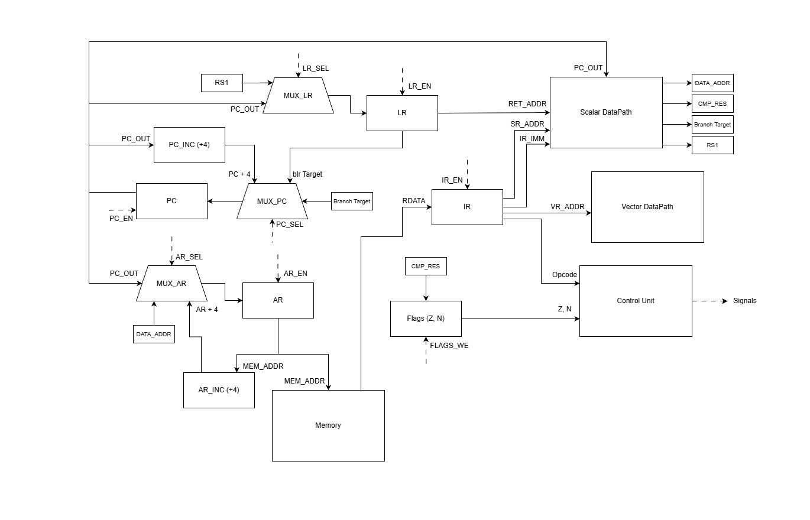
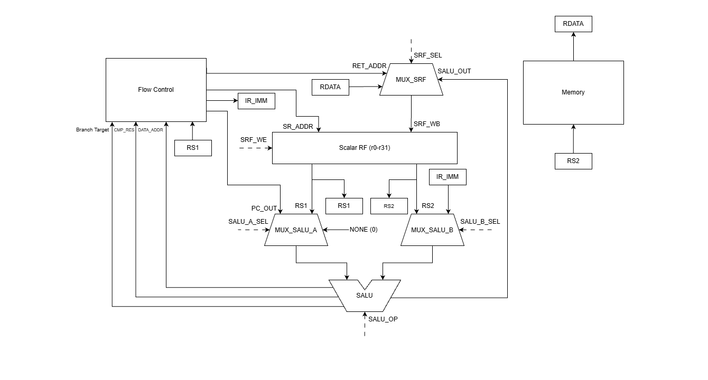
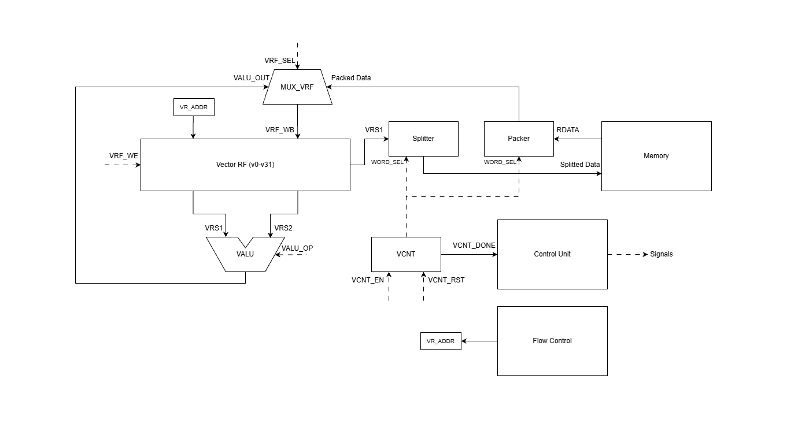
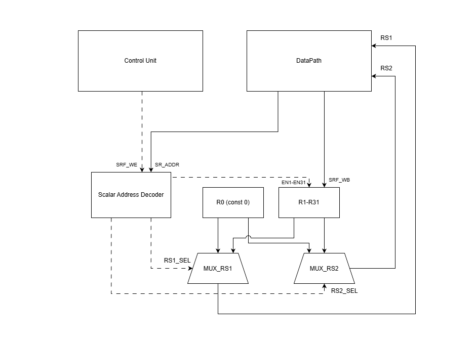

# Лабораторная работа №4. Эксперимент

* **Студент:** Валиуллин Даниил Равилевич
* **Группа:** P3231
* **Вариант:**
  ```text
  asm | risc | neum | mc | stream | mem | pstr | vector | alg2
  ```

---

## Язык программирования

Диалект языка ассемблера, стилизованный под архитектуру **PowerPC** с векторным расширением **AltiVec (VMX)**. Поддерживаются символьные метки, разделение на секции кода и данных, директива базового адреса `.org`, макросы препроцессора, а также экспорт и импорт символов для раздельной трансляции и компоновки.

### Синтаксис языка (БНФ)

```bnf
<program>            ::= { <line> }
<line>               ::= [ <label_decl> ] [ <statement> ] [ <comment> ] "\n"
<comment>            ::= ( "#" | ";" ) { <any_char> }
<label_decl>         ::= <identifier> ":"

<statement>          ::= <directive> | <instruction> | <macro_directive>

<directive>          ::= ".text"
                       | ".data"
                       | ".org" <number>
                       | ( ".global" | ".globl" ) <identifier>
                       | ".extern" <identifier>
                       | ".word" <num_list>
                       | ".byte" <num_list>
                       | ( ".pstr" | ".string" ) <string_literal>

<macro_directive>    ::= ( ".equ" | ".set" ) <identifier> [ <any_tokens> ]
                       | "%ifdef" <identifier> "\n" { <line> } "%endif"
                       | "%macro" <identifier> <integer> "\n" { <line> } "%endmacro"

<instruction>        ::= <mnemonic> [ <operand_list> ]
<operand_list>       ::= <operand> { "," <operand> }
<operand>            ::= <scalar_reg> | <vector_reg> | <mem_ref> | <immediate> | <identifier>

<scalar_reg>         ::= "r0" | "r1" | ... | "r31" | "sp"
<vector_reg>         ::= "v0" | "v1" | ... | "v31"
<mem_ref>            ::= [ <immediate> | <identifier> ] "(" <scalar_reg> ")"

<immediate>          ::= [ "-" ] ( <decimal_number> | <hex_number> )
<decimal_number>     ::= <digit> { <digit> }
<hex_number>         ::= "0x" <hex_digit> { <hex_digit> }
<string_literal>     ::= '"' { <escape_sequence> | <any_char> } '"'
```

### Семантика и организация данных
* **Модель исполнения:** последовательное потактовое исполнение команд. Поток управления меняется только инструкциями ветвлений (`beq`, `bne`, `blt`, `bge`, `ble`, `bgt`), безусловного перехода (`b`), вызова подпрограмм (`bl`) и возврата (`blr`).
* **Области видимости:** метки по умолчанию локальны для единицы трансляции (файла). Директива `.globl` делает символ доступным линкеру для межмодульных связей. Директива `.extern` объявляет символ, определённый в другом модуле.
* **Секции:**
  * `.text` — исполняемые машинные инструкции.
  * `.data` — статические данные (массивы слов, байты, строки).
* **Формат строк (`pstr`):**
  * Строки Паскаля (Pascal Strings) начинаются с префикса длины размером в 1 байт.
  * Следом располагаются байты символов в кодировке ASCII.
* **Выравнивание:** все 32-битные инструкции и слова `.word` выравниваются по 4-байтовой границе (`address % 4 == 0`).
* **Типизация:** язык является нетипизированным на уровне синтаксиса; все данные интерпретируются инструкциями в зависимости от операции как 32-битные целые числа (знаковые в дополнительном коде или беззнаковые), 8-битные байты (ASCII-символы, беззнаковые в `lbz`) или 128-битные векторы ($4 \times 32$ бит).
* **Литералы:** десятичные целые (`42`, `-1`), шестнадцатеричные (`0xFFFF_0004`), а также строковые литералы в двойных кавычках (`"Hello\n"`) с поддержкой escape-последовательностей.

---

## Организация памяти

### Модель памяти
* **Архитектура:** Фон-Неймановская байт-адресуемая память единого адресного пространства (адреса `0x00000000`–`0xFFFFFFFF`).
* **Машинное слово:** 32 бита (4 байта).

### Регистры
* **Скалярный регистровый файл (GPR):** 32 регистра по 32 бита (`r0`–`r31`):
  * `r0` — аппаратный ноль при адресации памяти `0(r0)`; запись в него игнорируется.
  * `r1` (`sp`) — указатель вершины стека.
  * `r2`–`r12` — регистры общего назначения (в соглашении вызовов `r3` используется для первого аргумента и возврата значения).
  * `r13`–`r31` — регистры общего назначения / сохранённые регистры.
* **Векторный регистровый файл (AltiVec / VMX):** 32 регистра (`v0`–`v31`) по 128 бит:
  * Каждый векторный регистр разбит на **4 дорожки (lanes) по 32 бита** (SIMD $4 \times 32$).
* **Служебные регистры:**
  * `PC` (Program Counter) — 32 бита.
  * `AR` (Address Register) — 32 бита.
  * `IR` (Instruction Register) — 32 бита.
  * `LR` (Link Register) — 32 бита, независимый регистр связи для возврата из подпрограмм. Заполняется командой `bl` (`LR = PC + 4`), восстанавливается в `PC` командой `blr`. Перенос в скалярные регистры и обратно осуществляется инструкциями `mflr` и `mtlr`.
  * `Flags (Z, N)` — флаги состояния АЛУ: $Z$ (Zero), $N$ (Negative). Обновляются при активном сигнале `FLAGS_WE` (инструкции `cmpw`, `cmplw`, `cmpwi`).

### Способы адресации и отображение элементов языка
* **Способы адресации:**
  * *Непосредственная* (`addi`, `cmpwi` — 16-битный литерал в поле `imm16`);
  * *Регистровая* (`add`, `vadduwm` — операнды в `r0–r31` и `v0–v31`);
  * *Косвенно-регистровая со смещением* (`lwz`, `stw`, `lvx`, `stvx` — эффективный адрес `rA + sext(imm16)`);
  * *PC-относительная со сдвигом `<< 2`* (`beq..bgt`, `b`, `bl` — цель `(PC + 4) + (sext(offset) << 2)`).
* **Литералы и константы:**
  * Именованные константы (`.equ`, `.set`) раскрываются препроцессором до первого прохода транслятора.
  * Короткие числовые литералы (`[-32768..32767]`) кодируются непосредственно в `imm16`; 32-битные константы и адреса (например, MMIO `0xFFFF0004`) собираются парой инструкций `lis` + `addi` через операторы `@h(...)` / `@l(...)`.
  * Многословные данные (массивы `.word`, строки `.pstr`) размещаются последовательно в секции `.data`; `.word` предварительно выравниваются по границе 4 байт.
* **Переменные:**
  * Скалярные локальные переменные отображаются на регистры `r2–r31` (долгоживущие значения в `r13–r31`), векторные — на `v0–v31`.
  * При нехватке регистров, а также для сохранения регистров и адреса возврата при вызовах функций используется **стек** в верхней памяти (растёт вниз от `r1`/`sp = 0xFFFFFFFF`).
  * Крупные буферы, массивы и строки размещаются в статической памяти секции `.data`.
* **Инструкции, процедуры и прерывания:**
  * Все инструкции имеют фиксированный размер 4 байта и располагаются последовательно в секции `.text` с адреса `.org` (по умолчанию `0x00000000`).
  * Процедуры оформляются метками (и экспортируются через `.globl`); вызов `bl` сохраняет `PC + 4` в `LR`, возврат `blr` восстанавливает `PC` из `LR`.
  * Аппаратные прерывания отсутствуют (модель ввода-вывода — синхронный поток `stream`).

### Карта адресного пространства
```text
+-----------------------+ 0x00000000
| Секция кода (.text)   |
+-----------------------+
| Секция данных (.data) |
| - Pascal-строки       |
| - Массивы (.word)     |
+-----------------------+ 0xFFFF0000
| STDIN_DATA (R)        | Порт чтения потока ввода
+-----------------------+ 0xFFFF0004
| STDOUT_DATA (W)       | Порт записи потока вывода
+-----------------------+ 0xFFFF0008
| Стек (вниз)           | <--- r1 (sp)
+-----------------------+ 0xFFFFFFFF
```

---

## Система команд (ISA)

* **Классификация:** архитектура **RISC** типа *load-store* — все арифметико-логические и SIMD-операции выполняются только над регистрами, а обращение к памяти и портам ввода-вывода вынесено в отдельные инструкции (`lwz`, `lbz`, `stw`, `stb`, `lvx`, `stvx`).
* **Ввод-вывод (`mem` + `stream`):** порты `STDIN_DATA` (`0xFFFF0000`) и `STDOUT_DATA` (`0xFFFF0004`) отображены в единое адресное пространство памяти и доступны обычными командами чтения/записи. При чтении из пустого буфера возвращается `-1` (`EOF`), по которому программа завершает чтение и останавливает процессор инструкцией `trap`.

### Форматы команд

```text
1. R-type (Регистровые операции АЛУ):
   [31:26 opcode (6)] [25:21 rd (5)] [20:16 rs1 (5)] [15:11 rs2 (5)] [10:0 pad (11)]

2. I-type (Непосредственные операции / Память):
   [31:26 opcode (6)] [25:21 rd (5)] [20:16 rs1 (5)] [15:0 imm16 (16)]

3. J/B-type (Условные и безусловные переходы, PC-относительные):
   [31:26 opcode (6)] [25:0 offset26 (26)]

4. V-type (Векторные операции AltiVec):
   [31:26 opcode (6)] [25:21 vd (5)] [20:16 vs1 (5)] [15:11 vs2 (5)] [10:0 pad (11)]

5. VL-type (Векторная загрузка / Сохранение):
   [31:26 opcode (6)] [25:21 vd (5)] [20:16 rs1 (5)] [15:0 imm16 (16)]
```

### Таблица системы команд

| Мнемоника | Синтаксис | Opcode | Тип | Описание | Такты |
|---|---|---|---|---|:---:|
| `nop` | `nop` | `0x00` | R | Нет операции | 3 |
| `add` | `add rD, rA, rB` | `0x01` | R | `rD = rA + rB` | 4 |
| `sub` | `sub rD, rA, rB` | `0x02` | R | `rD = rA - rB` | 4 |
| `mullw` | `mullw rD, rA, rB` | `0x03` | R | `rD = rA * rB` (32 бита) | 4 |
| `divw` | `divw rD, rA, rB` | `0x04` | R | `rD = rA // rB` | 4 |
| `modw` | `modw rD, rA, rB` | `0x05` | R | `rD = rA % rB` | 4 |
| `and` | `and rD, rA, rB` | `0x06` | R | `rD = rA & rB` | 4 |
| `or` | `or rD, rA, rB` | `0x07` | R | `rD = rA \| rB` (псевдокод `mr rD, rA`) | 4 |
| `xor` | `xor rD, rA, rB` | `0x08` | R | `rD = rA ^ rB` | 4 |
| `slw` | `slw rD, rA, rB` | `0x09` | R | Логический сдвиг влево на значение регистра | 4 |
| `srw` | `srw rD, rA, rB` | `0x0A` | R | Логический сдвиг вправо на значение регистра | 4 |
| `sraw` | `sraw rD, rA, rB` | `0x0B` | R | Арифметический сдвиг вправо на значение регистра | 4 |
| `cmpw` | `cmpw rA, rB` | `0x0C` | R | Знаковое сравнение `rA - rB` $\rightarrow$ FLAGS | 4 |
| `cmplw` | `cmplw rA, rB` | `0x0D` | R | Беззнаковое сравнение `rA - rB` $\rightarrow$ FLAGS | 4 |
| `addis` | `addis rD, rA, SIMM` | `0x0E` | I | `rD = rA + (SIMM << 16)` (псевдокод `lis rD, SIMM`) | 4 |
| `addi` | `addi rD, rA, SIMM` | `0x10` | I | `rD = rA + SIMM` (псевдокод `li rD, SIMM`) | 4 |
| `subi` | `subi rD, rA, SIMM` | `0x11` | I | `rD = rA - SIMM` | 4 |
| `andi` | `andi rD, rA, UIMM`| `0x12` | I | `rD = rA & UIMM` | 4 |
| `ori` | `ori rD, rA, UIMM` | `0x13` | I | `rD = rA \| UIMM` | 4 |
| `cmpwi` | `cmpwi rA, SIMM` | `0x14` | I | Знаковое сравнение `rA - SIMM` $\rightarrow$ FLAGS | 4 |
| `slwi` | `slwi rD, rA, SH` | `0x15` | I | Сдвиг влево на константу `SH` | 4 |
| `srwi` | `srwi rD, rA, SH` | `0x16` | I | Логический сдвиг вправо на константу `SH` | 4 |
| `srawi` | `srawi rD, rA, SH` | `0x17` | I | Арифметический сдвиг вправо на константу `SH` | 4 |
| `lwz` | `lwz rD, d(rA)` | `0x18` | I | Чтение 32-битного слова: `rD = MEM[rA + d]` | 5 |
| `lbz` | `lbz rD, d(rA)` | `0x19` | I | Чтение байта без знака: `rD = MEM[rA + d]` | 5 |
| `stw` | `stw rS, d(rA)` | `0x20` | I | Запись слова в память: `MEM[rA + d] = rS` | 5 |
| `stb` | `stb rS, d(rA)` | `0x21` | I | Запись байта в память: `MEM[rA + d] = rS[7:0]` | 5 |
| `beq` | `beq label` | `0x28` | B | Переход на `PC + 4 + (sext(offset26) << 2)`, если $Z=1$ (равно) | 4 |
| `bne` | `bne label` | `0x29` | B | Переход на `PC + 4 + (sext(offset26) << 2)`, если $Z=0$ (не равно) | 4 |
| `blt` | `blt label` | `0x2A` | B | Переход на `PC + 4 + (sext(offset26) << 2)`, если $N=1$ (меньше) | 4 |
| `bge` | `bge label` | `0x2B` | B | Переход на `PC + 4 + (sext(offset26) << 2)`, если $N=0$ (больше или равно) | 4 |
| `ble` | `ble label` | `0x2C` | B | Переход на `PC + 4 + (sext(offset26) << 2)`, если $N=1 \lor Z=1$ | 4 |
| `bgt` | `bgt label` | `0x2D` | B | Переход на `PC + 4 + (sext(offset26) << 2)`, если $N=0 \land Z=0$ | 4 |
| `b` | `b target` | `0x30` | J | Безусловный переход: `PC = PC + 4 + (sext(offset26) << 2)` | 4 |
| `bl` | `bl target` | `0x31` | J | Вызов функции: `LR = PC + 4; PC = PC + 4 + (sext(offset26) << 2)` | 5 |
| `blr` | `blr` | `0x32` | R | Возврат из функции: `PC = LR` | 4 |
| `mflr` | `mflr rD` | `0x33` | R | Копирование link register в `rD` | 4 |
| `vadduwm`| `vadduwm vD, vA, vB`| `0x34`| V | Параллельное сложение 4-х слов | 4 |
| `vsubuwm`| `vsubuwm vD, vA, vB`| `0x35`| V | Параллельное вычитание 4-х слов | 4 |
| `vmuluwm`| `vmuluwm vD, vA, vB`| `0x36`| V | Параллельное умножение 4-х слов | 4 |
| `vdivuwm`| `vdivuwm vD, vA, vB`| `0x37`| V | Параллельное деление 4-х слов | 4 |
| `vcmpequw`|`vcmpequw vD, vA, vB`| `0x38`| V | Параллельное сравнение 4-х слов | 4 |
| `lvx` | `lvx vD, d(rA)` | `0x39` | VL | Векторная загрузка 128 бит (4 последовательных слова) | 7 |
| `stvx` | `stvx vS, d(rA)` | `0x3A` | VL | Векторное сохранение 128 бит (4 последовательных слова)| 7 |
| `mtlr` | `mtlr rS` | `0x3B` | R | Копирование `rS` в link register | 4 |
| `trap` | `trap` | `0x3F` | R | Останов симулятора (`self.halted = True`) | 3 |

---

## Схема процессора и Control Unit

### Flow Control


### Scalar DataPath


### Vector DataPath


### Scalar Register File


### Vector Register File


### Control Unit


### Узлы и имена сигналов по схемам:
* **Flow Control:** `PC` (`PC_EN`, `PC_OUT`), `PC_INC (+4)`, `MUX_PC` (`PC_SEL`), `LR` (`LR_EN`, `RS1`, `RET_ADDR`, `blr Target`), `MUX_LR` (`LR_SEL`), `AR` (`AR_EN`, `MEM_ADDR`), `AR_INC (+4)` (`AR + 4`), `MUX_AR` (`AR_SEL`), `IR` (`IR_EN`, `SR_ADDR`, `VR_ADDR`, `IR_IMM`, `Opcode`), `Flags (Z, N)` (`FLAGS_WE`, `CMP_RES`).
* **Scalar DataPath:** `Scalar RF` (`SRF_WE`, `SR_ADDR`, `SRF_WB`, `RS1_SEL`, `RS2_SEL`, `EN1-EN31`, `MUX_RS1`, `MUX_RS2`), `Scalar Address Decoder`, `MUX_SRF` (`SRF_SEL`), `MUX_SALU_A` (`SALU_A_SEL`), `MUX_SALU_B` (`SALU_B_SEL`), `SALU` (`SALU_OP`, `SALU_OUT`, `DATA_ADDR`, `CMP_RES`, `Branch Target`), шины `RS1`, `RS2`, `IR_IMM`, `RDATA`.
* **Vector DataPath:** `Vector RF` (`VRF_WE`, `VR_ADDR`, `VRF_WB`, `VRS1_SEL`, `VRS2_SEL`, `EN0-EN31`, `Lane 0..3`, `MUX_Lk_R1`, `MUX_Lk_R2`), `Vector Address Decoder`, `MUX_VRF` (`VRF_SEL`), `VALU` (`VALU_OP`, `VALU_OUT`), `Splitter` (`Splitted Data`), `Packer` (`Packed Data`), `VCNT` (`VCNT_EN`, `VCNT_RST`, `VCNT_DONE`, `WORD_SEL`).
* **Memory:** `MEM_ADDR`, `RDATA`, `WDATA`, `Splitted Data`, `Memory Address Decoder` (`MEM_SEL`), `RAM / MMIO`, `Byte Aligner` (`stb / stw Data`), `MUX_WDATA` (`WDATA_SEL`), `MEM_READ`, `MEM_WRITE`, `MEM_SIZE`.
* **Control Unit:** `MAP_ROM` (`MAP_ADDR`), `MIR`, `MPC`, `MPC_INC (+1)`, `ROM` (`M_ADDR`, `Microcode`), `MUX_MPC` (`SEQ_OP`: `NEXT_MADDR`, `MPC_INC`, `MAP_ADDR`, `FLAG_STATUS`, `FETCH0`), `MUX_COND` (`COND_SEL`, `UNCOND`, `Flags`, `VCNT_DONE`, `Flag Status`).

### Формат микроинструкции и особенности реализации моделирования
* Управляющая память (`ROM`) хранит 256 микроинструкций (`MIR`), каждая из которых задаёт управляющие сигналы тракта данных (`SALU_A_SEL`, `SALU_B_SEL`, `SALU_OP`, `SRF_SEL`, `SRF_WE`, `VALU_OP`, `VRF_SEL`, `VRF_WE`, `VCNT_RST`, `VCNT_EN`, `PC_SEL`, `PC_EN`, `LR_SEL`, `LR_EN`, `AR_SEL`, `AR_EN`, `IR_EN`, `FLAGS_WE`, `MEM_READ`, `MEM_WRITE`, `MEM_SIZE`, `WDATA_SEL`, `HALT_EN`) и поля секвенсора (`COND_SEL`, `SEQ_OP`, `NEXT_MADDR`).
* На каждом такте `ControlUnit.step()` считывает `ROM[MPC]` в `MIR`, выполняет микрооперации текущего такта, проверяет условие в `MUX_COND` и через `MUX_MPC` выбирает следующий адрес `MPC` (`FETCH0`, `MPC_INC`, `MAP_ADDR` из `MAP_ROM`, `NEXT_MADDR` или `FLAG_STATUS`).
* Память реализована как разреженное 32-битное пространство (`SparseMemory`), ввод-вывод — через буферы `io_input_buffer` и `io_output_buffer`. Останов симуляции происходит при `HALT_EN=1` (`trap`) либо по достижении `--limit`.

### Таблица микрокода

#### Часть А: Общие циклы (Выборка, Декод, NOP, TRAP)

| Адрес `MPC` | Метка | Такт | Активные управляющие сигналы (`MIR`) | Переход (`SEQ_OP`) | Описание действия |
| :---: | :--- | :---: | :--- | :--- | :--- |
| **`0x00`** | `FETCH` | 1 | `AR_SEL=PC_OUT, AR_EN=1, MEM_READ=1, MEM_SIZE=WORD, IR_EN=1, PC_SEL=PC_PLUS_4, PC_EN=1` | `MPC_INC` | Чтение команды `IR <= MEM[PC]`, инкремент `PC <= PC + 4` |
| **`0x01`** | `DECODE` | 2 | `VCNT_RST=1` | `MAP_ADDR` | Сброс векторного счётчика, переход по опкоду на старт микропрограммы |
| **`0x02`** | `NOP_END` | 3 | *(Все стробы = 0)* | `FETCH0` | **nop** (3 такта): переход к следующей команде |
| **`0x03`** | `TRAP` | 3 | `HALT_EN=1, COND_SEL=UNCOND` | `FLAG_STATUS (UNCOND -> 0x03)` | **trap** (3 такта): останов процессора (`self.halted = True`) |

---

#### Часть B: Скалярные команды R-типа и `addis` (4 такта)

| Адрес `MPC` | Команда / Метка | Такт | Активные сигналы | Переход (`SEQ_OP`) | Действие |
| :---: | :--- | :---: | :--- | :--- | :--- |
| **`0x04`** | `ADD_EX` | 3 | `SALU_A_SEL=RS1, SALU_B_SEL=RS2, SALU_OP=ADD` | `MPC_INC` | **add**: `RS1 + RS2` |
| **`0x05`** | `ADD_WB` | 4 | `SALU_A_SEL=RS1, SALU_B_SEL=RS2, SALU_OP=ADD, SRF_SEL=SALU_OUT, SRF_WE=1` | `FETCH0` | Запись результата в `rD` |
| **`0x06`** | `SUB_EX` | 3 | `SALU_A_SEL=RS1, SALU_B_SEL=RS2, SALU_OP=SUB` | `MPC_INC` | **sub**: `RS1 - RS2` |
| **`0x07`** | `SUB_WB` | 4 | `SALU_A_SEL=RS1, SALU_B_SEL=RS2, SALU_OP=SUB, SRF_SEL=SALU_OUT, SRF_WE=1` | `FETCH0` | Запись в `rD` |
| **`0x08`** | `MULLW_EX` | 3 | `SALU_A_SEL=RS1, SALU_B_SEL=RS2, SALU_OP=MUL` | `MPC_INC` | **mullw**: `RS1 * RS2` |
| **`0x09`** | `MULLW_WB` | 4 | `SALU_A_SEL=RS1, SALU_B_SEL=RS2, SALU_OP=MUL, SRF_SEL=SALU_OUT, SRF_WE=1` | `FETCH0` | Запись в `rD` |
| **`0x0A`** | `DIVW_EX` | 3 | `SALU_A_SEL=RS1, SALU_B_SEL=RS2, SALU_OP=DIV` | `MPC_INC` | **divw**: `RS1 // RS2` |
| **`0x0B`** | `DIVW_WB` | 4 | `SALU_A_SEL=RS1, SALU_B_SEL=RS2, SALU_OP=DIV, SRF_SEL=SALU_OUT, SRF_WE=1` | `FETCH0` | Запись в `rD` |
| **`0x0C`** | `MODW_EX` | 3 | `SALU_A_SEL=RS1, SALU_B_SEL=RS2, SALU_OP=MOD` | `MPC_INC` | **modw**: `RS1 % RS2` |
| **`0x0D`** | `MODW_WB` | 4 | `SALU_A_SEL=RS1, SALU_B_SEL=RS2, SALU_OP=MOD, SRF_SEL=SALU_OUT, SRF_WE=1` | `FETCH0` | Запись в `rD` |
| **`0x0E`** | `AND_EX` | 3 | `SALU_A_SEL=RS1, SALU_B_SEL=RS2, SALU_OP=AND` | `MPC_INC` | **and**: `RS1 & RS2` |
| **`0x0F`** | `AND_WB` | 4 | `SALU_A_SEL=RS1, SALU_B_SEL=RS2, SALU_OP=AND, SRF_SEL=SALU_OUT, SRF_WE=1` | `FETCH0` | Запись в `rD` |
| **`0x10`** | `OR_EX` | 3 | `SALU_A_SEL=RS1, SALU_B_SEL=RS2, SALU_OP=OR` | `MPC_INC` | **or**: `RS1 \| RS2` |
| **`0x11`** | `OR_WB` | 4 | `SALU_A_SEL=RS1, SALU_B_SEL=RS2, SALU_OP=OR, SRF_SEL=SALU_OUT, SRF_WE=1` | `FETCH0` | Запись в `rD` |
| **`0x12`** | `XOR_EX` | 3 | `SALU_A_SEL=RS1, SALU_B_SEL=RS2, SALU_OP=XOR` | `MPC_INC` | **xor**: `RS1 ^ RS2` |
| **`0x13`** | `XOR_WB` | 4 | `SALU_A_SEL=RS1, SALU_B_SEL=RS2, SALU_OP=XOR, SRF_SEL=SALU_OUT, SRF_WE=1` | `FETCH0` | Запись в `rD` |
| **`0x14`** | `SLW_EX` | 3 | `SALU_A_SEL=RS1, SALU_B_SEL=RS2, SALU_OP=LSL` | `MPC_INC` | **slw**: `RS1 << RS2` |
| **`0x15`** | `SLW_WB` | 4 | `SALU_A_SEL=RS1, SALU_B_SEL=RS2, SALU_OP=LSL, SRF_SEL=SALU_OUT, SRF_WE=1` | `FETCH0` | Запись в `rD` |
| **`0x16`** | `SRW_EX` | 3 | `SALU_A_SEL=RS1, SALU_B_SEL=RS2, SALU_OP=LSR` | `MPC_INC` | **srw**: `RS1 >> RS2` (лог.) |
| **`0x17`** | `SRW_WB` | 4 | `SALU_A_SEL=RS1, SALU_B_SEL=RS2, SALU_OP=LSR, SRF_SEL=SALU_OUT, SRF_WE=1` | `FETCH0` | Запись в `rD` |
| **`0x18`** | `SRAW_EX` | 3 | `SALU_A_SEL=RS1, SALU_B_SEL=RS2, SALU_OP=ASR` | `MPC_INC` | **sraw**: `RS1 >>> RS2` (арифм.) |
| **`0x19`** | `SRAW_WB` | 4 | `SALU_A_SEL=RS1, SALU_B_SEL=RS2, SALU_OP=ASR, SRF_SEL=SALU_OUT, SRF_WE=1` | `FETCH0` | Запись в `rD` |
| **`0x1A`** | `CMPW_EX` | 3 | `SALU_A_SEL=RS1, SALU_B_SEL=RS2, SALU_OP=CMP` | `MPC_INC` | **cmpw**: знаковое сравнение |
| **`0x1B`** | `CMPW_WB` | 4 | `SALU_A_SEL=RS1, SALU_B_SEL=RS2, SALU_OP=CMP, FLAGS_WE=1` | `FETCH0` | Фиксация флагов `Z, N` |
| **`0x1C`** | `CMPLW_EX`| 3 | `SALU_A_SEL=RS1, SALU_B_SEL=RS2, SALU_OP=CMPL` | `MPC_INC` | **cmplw**: беззнаковое сравнение |
| **`0x1D`** | `CMPLW_WB`| 4 | `SALU_A_SEL=RS1, SALU_B_SEL=RS2, SALU_OP=CMPL, FLAGS_WE=1` | `FETCH0` | Фиксация флагов `Z, N` |
| **`0x1E`** | `ADDIS_EX`| 3 | `SALU_A_SEL=RS1, SALU_B_SEL=IR_IMM, SALU_OP=ADDIS` | `MPC_INC` | **addis**: `RS1 + (SIMM << 16)` |
| **`0x1F`** | `ADDIS_WB`| 4 | `SALU_A_SEL=RS1, SALU_B_SEL=IR_IMM, SALU_OP=ADDIS, SRF_SEL=SALU_OUT, SRF_WE=1` | `FETCH0` | Запись в `rD` |

---

#### Часть C: Скалярные команды I-типа (4 такта)

| Адрес `MPC` | Команда / Метка | Такт | Активные сигналы | Переход (`SEQ_OP`) | Действие |
| :---: | :--- | :---: | :--- | :--- | :--- |
| **`0x20`** | `ADDI_EX` | 3 | `SALU_A_SEL=RS1, SALU_B_SEL=IR_IMM, SALU_OP=ADD` | `MPC_INC` | **addi**: `RS1 + SIMM` |
| **`0x21`** | `ADDI_WB` | 4 | `SALU_A_SEL=RS1, SALU_B_SEL=IR_IMM, SALU_OP=ADD, SRF_SEL=SALU_OUT, SRF_WE=1` | `FETCH0` | Запись в `rD` |
| **`0x22`** | `SUBI_EX` | 3 | `SALU_A_SEL=RS1, SALU_B_SEL=IR_IMM, SALU_OP=SUB` | `MPC_INC` | **subi**: `RS1 - SIMM` |
| **`0x23`** | `SUBI_WB` | 4 | `SALU_A_SEL=RS1, SALU_B_SEL=IR_IMM, SALU_OP=SUB, SRF_SEL=SALU_OUT, SRF_WE=1` | `FETCH0` | Запись в `rD` |
| **`0x24`** | `ANDI_EX` | 3 | `SALU_A_SEL=RS1, SALU_B_SEL=IR_IMM, SALU_OP=AND` | `MPC_INC` | **andi**: `RS1 & UIMM` |
| **`0x25`** | `ANDI_WB` | 4 | `SALU_A_SEL=RS1, SALU_B_SEL=IR_IMM, SALU_OP=AND, SRF_SEL=SALU_OUT, SRF_WE=1` | `FETCH0` | Запись в `rD` |
| **`0x26`** | `ORI_EX` | 3 | `SALU_A_SEL=RS1, SALU_B_SEL=IR_IMM, SALU_OP=OR` | `MPC_INC` | **ori**: `RS1 \| UIMM` |
| **`0x27`** | `ORI_WB` | 4 | `SALU_A_SEL=RS1, SALU_B_SEL=IR_IMM, SALU_OP=OR, SRF_SEL=SALU_OUT, SRF_WE=1` | `FETCH0` | Запись в `rD` |
| **`0x28`** | `CMPWI_EX`| 3 | `SALU_A_SEL=RS1, SALU_B_SEL=IR_IMM, SALU_OP=CMP` | `MPC_INC` | **cmpwi**: сравнение `RS1 - SIMM` |
| **`0x29`** | `CMPWI_WB`| 4 | `SALU_A_SEL=RS1, SALU_B_SEL=IR_IMM, SALU_OP=CMP, FLAGS_WE=1` | `FETCH0` | Фиксация флагов `Z, N` |
| **`0x2A`** | `SLWI_EX` | 3 | `SALU_A_SEL=RS1, SALU_B_SEL=IR_IMM, SALU_OP=LSL` | `MPC_INC` | **slwi**: `RS1 << SH` |
| **`0x2B`** | `SLWI_WB` | 4 | `SALU_A_SEL=RS1, SALU_B_SEL=IR_IMM, SALU_OP=LSL, SRF_SEL=SALU_OUT, SRF_WE=1` | `FETCH0` | Запись в `rD` |
| **`0x2C`** | `SRWI_EX` | 3 | `SALU_A_SEL=RS1, SALU_B_SEL=IR_IMM, SALU_OP=LSR` | `MPC_INC` | **srwi**: `RS1 >> SH` |
| **`0x2D`** | `SRWI_WB` | 4 | `SALU_A_SEL=RS1, SALU_B_SEL=IR_IMM, SALU_OP=LSR, SRF_SEL=SALU_OUT, SRF_WE=1` | `FETCH0` | Запись в `rD` |
| **`0x2E`** | `SRAWI_EX`| 3 | `SALU_A_SEL=RS1, SALU_B_SEL=IR_IMM, SALU_OP=ASR` | `MPC_INC` | **srawi**: `RS1 >>> SH` |
| **`0x2F`** | `SRAWI_WB`| 4 | `SALU_A_SEL=RS1, SALU_B_SEL=IR_IMM, SALU_OP=ASR, SRF_SEL=SALU_OUT, SRF_WE=1` | `FETCH0` | Запись в `rD` |

---

#### Часть D: Скалярный доступ к памяти / MMIO (5 тактов)

| Адрес `MPC` | Команда / Метка | Такт | Активные сигналы | Переход (`SEQ_OP`) | Действие |
| :---: | :--- | :---: | :--- | :--- | :--- |
| **`0x30`** | `LWZ_ADDR`| 3 | `SALU_A_SEL=RS1, SALU_B_SEL=IR_IMM, SALU_OP=ADD, AR_SEL=DATA_ADDR, AR_EN=1` | `MPC_INC` | **lwz**: `AR <= RS1 + d` |
| **`0x31`** | `LWZ_MEM` | 4 | `MEM_READ=1, MEM_SIZE=WORD` | `MPC_INC` | Чтение 32-бит слова из RAM / MMIO в `RDATA` |
| **`0x32`** | `LWZ_WB` | 5 | `SRF_SEL=RDATA, SRF_WE=1` | `FETCH0` | Запись `RDATA` в `rD` |
| **`0x33`** | `LBZ_ADDR`| 3 | `SALU_A_SEL=RS1, SALU_B_SEL=IR_IMM, SALU_OP=ADD, AR_SEL=DATA_ADDR, AR_EN=1` | `MPC_INC` | **lbz**: `AR <= RS1 + d` |
| **`0x34`** | `LBZ_MEM` | 4 | `MEM_READ=1, MEM_SIZE=BYTE` | `MPC_INC` | Чтение 1 байта с расширением нулями в `RDATA` |
| **`0x35`** | `LBZ_WB` | 5 | `SRF_SEL=RDATA, SRF_WE=1` | `FETCH0` | Запись байта из `RDATA` в `rD` |
| **`0x36`** | `STW_ADDR`| 3 | `SALU_A_SEL=RS1, SALU_B_SEL=IR_IMM, SALU_OP=ADD, AR_SEL=DATA_ADDR, AR_EN=1` | `MPC_INC` | **stw**: `AR <= RS1 + d` |
| **`0x37`** | `STW_MEM` | 4 | `WDATA_SEL=STB_STW_DATA, MEM_SIZE=WORD, MEM_WRITE=1` | `MPC_INC` | Запись слова из `rS` (поле `rd`) в RAM / MMIO |
| **`0x38`** | `STW_END` | 5 | *(Завершение цикла шины)* | `FETCH0` | Завершение записи |
| **`0x39`** | `STB_ADDR`| 3 | `SALU_A_SEL=RS1, SALU_B_SEL=IR_IMM, SALU_OP=ADD, AR_SEL=DATA_ADDR, AR_EN=1` | `MPC_INC` | **stb**: `AR <= RS1 + d` |
| **`0x3A`** | `STB_MEM` | 4 | `WDATA_SEL=STB_STW_DATA, MEM_SIZE=BYTE, MEM_WRITE=1` | `MPC_INC` | Запись младшего байта `rS[7:0]` (поле `rd`) |
| **`0x3B`** | `STB_END` | 5 | *(Завершение цикла шины)* | `FETCH0` | Завершение записи |

---

#### Часть E: Ветвления, переходы и работа с `LR` (4–5 тактов)

| Адрес `MPC` | Команда / Метка | Такт | Активные сигналы | Переход (`SEQ_OP`) | Действие |
| :---: | :--- | :---: | :--- | :--- | :--- |
| **`0x40`** | `BEQ_CHK` | 3 | `COND_SEL=EQ` | `FLAG_STATUS (Z == 1 -> 0x4C)` / `MPC_INC` | **beq**: Если истина $\to$ `0x4C`, иначе `0x41` |
| **`0x41`** | `BEQ_NO` | 4 | *(Условие ложно, PC не меняем)* | `FETCH0` | Возврат на выборку |
| **`0x42`** | `BNE_CHK` | 3 | `COND_SEL=NE` | `FLAG_STATUS (Z == 0 -> 0x4C)` / `MPC_INC` | **bne**: Если истина $\to$ `0x4C`, иначе `0x43` |
| **`0x43`** | `BNE_NO` | 4 | *(Условие ложно)* | `FETCH0` | Возврат на выборку |
| **`0x44`** | `BLT_CHK` | 3 | `COND_SEL=LT` | `FLAG_STATUS (N == 1 -> 0x4C)` / `MPC_INC` | **blt**: Если истина $\to$ `0x4C`, иначе `0x45` |
| **`0x45`** | `BLT_NO` | 4 | *(Условие ложно)* | `FETCH0` | Возврат на выборку |
| **`0x46`** | `BGE_CHK` | 3 | `COND_SEL=GE` | `FLAG_STATUS (N == 0 -> 0x4C)` / `MPC_INC` | **bge**: Если истина $\to$ `0x4C`, иначе `0x47` |
| **`0x47`** | `BGE_NO` | 4 | *(Условие ложно)* | `FETCH0` | Возврат на выборку |
| **`0x48`** | `BLE_CHK` | 3 | `COND_SEL=LE` | `FLAG_STATUS (N == 1 \|\| Z == 1 -> 0x4C)` / `MPC_INC` | **ble**: Если истина $\to$ `0x4C`, иначе `0x49` |
| **`0x49`** | `BLE_NO` | 4 | *(Условие ложно)* | `FETCH0` | Возврат на выборку |
| **`0x4A`** | `BGT_CHK` | 3 | `COND_SEL=GT` | `FLAG_STATUS (N == 0 && Z == 0 -> 0x4C)` / `MPC_INC` | **bgt**: Если истина $\to$ `0x4C`, иначе `0x4B` |
| **`0x4B`** | `BGT_NO` | 4 | *(Условие ложно)* | `FETCH0` | Возврат на выборку |
| **`0x4C`** | `BR_TAKEN`| 4 | `SALU_A_SEL=PC_OUT, SALU_B_SEL=IR_IMM, SALU_OP=ADD, PC_SEL=BRANCH_TARGET, PC_EN=1` | `FETCH0` | Общий шаг перехода: `PC <= Branch Target` |
| **`0x4E`** | `B_PREP` | 3 | `SALU_A_SEL=PC_OUT, SALU_B_SEL=IR_IMM, SALU_OP=ADD` | `MPC_INC` | **b** (4 такта): подготовка `Target` |
| **`0x4F`** | `B_EXEC` | 4 | `SALU_A_SEL=PC_OUT, SALU_B_SEL=IR_IMM, SALU_OP=ADD, PC_SEL=BRANCH_TARGET, PC_EN=1` | `FETCH0` | Безусловный переход: `PC <= Target` |
| **`0x50`** | `BL_SAVE` | 3 | `LR_SEL=PC_OUT, LR_EN=1` | `MPC_INC` | **bl** (5 тактов): `LR <= PC_OUT` (`PC_orig + 4`) |
| **`0x51`** | `BL_PREP` | 4 | `SALU_A_SEL=PC_OUT, SALU_B_SEL=IR_IMM, SALU_OP=ADD` | `MPC_INC` | Подготовка целевого адреса функции |
| **`0x52`** | `BL_EXEC` | 5 | `SALU_A_SEL=PC_OUT, SALU_B_SEL=IR_IMM, SALU_OP=ADD, PC_SEL=BRANCH_TARGET, PC_EN=1` | `FETCH0` | Прыжок в подпрограмму: `PC <= Target` |
| **`0x53`** | `BLR_PREP`| 3 | `PC_SEL=BLR_TARGET` | `MPC_INC` | **blr** (4 такта): подача `LR` на `MUX_PC` |
| **`0x54`** | `BLR_EXEC`| 4 | `PC_SEL=BLR_TARGET, PC_EN=1` | `FETCH0` | Возврат из функции: `PC <= LR` |
| **`0x55`** | `MFLR_PRP`| 3 | `SRF_SEL=RET_ADDR` | `MPC_INC` | **mflr** (4 такта): подача `RET_ADDR` на `MUX_SRF` |
| **`0x56`** | `MFLR_WB` | 4 | `SRF_SEL=RET_ADDR, SRF_WE=1` | `FETCH0` | Запись: `rD <= LR` |
| **`0x57`** | `MTLR_PRP`| 3 | `LR_SEL=RS1` | `MPC_INC` | **mtlr** (4 такта): выбор шины `RS1` на `MUX_LR` |
| **`0x58`** | `MTLR_WB` | 4 | `LR_SEL=RS1, LR_EN=1` | `FETCH0` | Запись: `LR <= RS1` |

---

#### Часть F: Векторная SIMD-арифметика (4 такта)

| Адрес `MPC` | Команда / Метка | Такт | Активные сигналы | Переход (`SEQ_OP`) | Действие |
| :---: | :--- | :---: | :--- | :--- | :--- |
| **`0x60`** | `VADD_EX` | 3 | `VALU_OP=VADD` | `MPC_INC` | **vadduwm**: 4-слотовое сложение |
| **`0x61`** | `VADD_WB` | 4 | `VALU_OP=VADD, VRF_SEL=VALU_OUT, VRF_WE=1` | `FETCH0` | Запись 128 бит в `vD` |
| **`0x62`** | `VSUB_EX` | 3 | `VALU_OP=VSUB` | `MPC_INC` | **vsubuwm**: 4-слотовое вычитание |
| **`0x63`** | `VSUB_WB` | 4 | `VALU_OP=VSUB, VRF_SEL=VALU_OUT, VRF_WE=1` | `FETCH0` | Запись в `vD` |
| **`0x64`** | `VMUL_EX` | 3 | `VALU_OP=VMUL` | `MPC_INC` | **vmuluwm**: 4-слотовое умножение |
| **`0x65`** | `VMUL_WB` | 4 | `VALU_OP=VMUL, VRF_SEL=VALU_OUT, VRF_WE=1` | `FETCH0` | Запись в `vD` |
| **`0x66`** | `VDIV_EX` | 3 | `VALU_OP=VDIV` | `MPC_INC` | **vdivuwm**: 4-слотовое деление |
| **`0x67`** | `VDIV_WB` | 4 | `VALU_OP=VDIV, VRF_SEL=VALU_OUT, VRF_WE=1` | `FETCH0` | Запись в `vD` |
| **`0x68`** | `VCMP_EX` | 3 | `VALU_OP=VCMP` | `MPC_INC` | **vcmpequw**: 4-слотовое сравнение |
| **`0x69`** | `VCMP_WB` | 4 | `VALU_OP=VCMP, VRF_SEL=VALU_OUT, VRF_WE=1` | `FETCH0` | Запись масок равенства в `vD` |

---

#### Часть G: Векторная память (`lvx`, `stvx` — 7 тактов)

| Адрес `MPC` | Команда / Метка | Такт | Активные сигналы | Переход (`SEQ_OP`) | Действие |
| :---: | :--- | :---: | :--- | :--- | :--- |
| **`0x70`** | `LVX_LOOP`| 3–6 | `SALU_A_SEL=RS1, SALU_B_SEL=IR_IMM, SALU_OP=ADD, AR_SEL=(VCNT==0 ? DATA_ADDR : AR_PLUS_4), AR_EN=1, MEM_READ=1, MEM_SIZE=WORD, VALU_OP=VLD, VCNT_EN=1, COND_SEL=VCNT_LOOP` | `FLAG_STATUS (!VCNT_DONE -> 0x70)` / `MPC_INC` | **lvx**: на `VCNT==0` вычисляет `AR <= RS1 + d`, далее шагает `AR <= AR + 4` через `AR_INC`, читает слова 0–3 в `Packer`. При `VCNT == 3` (`VCNT_DONE`) выходит на `0x71` |
| **`0x71`** | `LVX_WB` | 7 | `VRF_SEL=PACKED_DATA, VRF_WE=1` | `FETCH0` | Запись собранного 128-битного вектора в `vD` |
| **`0x72`** | `STVX_LP` | 3–6 | `SALU_A_SEL=RS1, SALU_B_SEL=IR_IMM, SALU_OP=ADD, AR_SEL=(VCNT==0 ? DATA_ADDR : AR_PLUS_4), AR_EN=1, VALU_OP=VST, WDATA_SEL=SPLITTED_DATA, MEM_SIZE=WORD, MEM_WRITE=1, VCNT_EN=1, COND_SEL=VCNT_LOOP` | `FLAG_STATUS (!VCNT_DONE -> 0x72)` / `MPC_INC` | **stvx**: вычисляет `AR` / шагает через `AR_INC`, нарезает 128 бит через `Splitter` и пишет слова 0–3 в память. При `VCNT == 3` выходит на `0x73` |
| **`0x73`** | `STVX_END`| 7 | *(Завершение цикла записи шины)* | `FETCH0` | Конец операции, возврат на `0x00` |

---

## Транслятор и компоновщик

### Архитектура транслятора (`src/translator/translator.py`)
Транслятор преобразует исходный текст `.asm` в объектный файл `.o`, содержащий сериализованный объектный модуль (`ObjectModule`) с таблицами символов и релокаций.
1. **Препроцессор:**
   * Операторы выделения старших и младших 16 бит констант `@h(...)` и `@l(...)`.
   * Подстановка макросов `%macro` с аргументами.
   * Константы `.equ` / `.set`.
   * Условная компиляция `%ifdef ... %endif`.
   * Удаление комментариев (`#`, `;`) и пустых строк.
2. **Сортировка секций:**
   * Все строки классифицируются по секциям `.text` и `.data`.
   * Секция `.text` всегда размещается первой.
3. **Первый проход (Pass 1):**
   * Вычисление смещений символов.
   * Учёт реальной длины строк `.pstr` после декодирования экранированных символов.
   * Выравнивание директив `.word` по 4 байтам.
4. **Второй проход (Pass 2):**
   * Генерация машинных слов.
   * Формирование таблицы символов `symbols` и таблицы перемещений `relocations` (`ABS16`, `REL26`).

### Компоновщик (`src/linker.py`)
Линкер загружает произвольное число `.o`-файлов:
1. **Распределение адресов:** модуль с директивой `.org` размещается по указанному адресу (по умолчанию `0x0`), библиотеки компонуются следом с выравниванием по 4 байтам.
2. **Разрешение внешних ссылок:** глобальные символы `.globl` связываются с внешними вызовами `.extern`.
3. **Применение релокаций:** адреса переходов и ссылок на данные патчатся в бинарный образ `image`.
4. **Вывод результатов:**
   * Бинарный файл машинного кода (`.bin`).
   * Текстовый отладочный листинг формата: `<address> - <HEXCODE> - <mnemonic>`.

### Полный цикл сборки и запуска
Процесс разделён на три независимых этапа:

1. Создание объектных файлов:
   ```bash
   python -m src.translator <input_file.asm> [-o object_file.o]
   ```

**Входные данные**:
* `input_file.asm` - файл с исходным кодом программы на языке ассемблера.

**Выходные данные**:
* `object_file.o` - объектный JSON-файл (по умолчанию out/<имя_файла>.o).
* `source_code.preprocessed` - файл с исходным кодом после препроцессинга.

2. Компоновка объектных файлов:
   ```bash
   python -m src.linker <object_file.o> [lib.o] -o <binary_file.bin>
   ```

**Входные данные**:
* `object_file.o` - объектный JSON-файл.
* `lib.o` - объектный файл библиотеки с функциями для основной программы.

**Выходные данные**:
* `binary_file.bin` - исполняемый бинарный файл.
* `memory.dump` - файл с отчетом об использовании памяти, символьной таблицей и листингом в формате: `<address> - <HEXCODE> - <mnemonic>`

3. Запуск бинарного файла:
   ```bash
   python -m src.machine <binary_file.bin> [--input input.txt] [--log log_file.log] [--debug] [--limit limit_ticks]
   ```

**Входные данные**:
* `binary_file.bin` - исполняемый бинарный файл.
* `input.txt` (опционально, `i`/`--input`) - файл с входными данными, поступающими по адресу ввода.

**Выходные данные**:
* `log_file.log` (опционально, `-l`/`--log`) - файл с логами. Если не указан путь к файлу, выводится в `stderr`. Флаг `--debug` дает подробный вывод по каждому такту. Флаг `--limit` устанавливает лимит на количество тактов.

---

## Тестирование

Тестирование организовано через интеграционные **Golden Tests** на базе `pytest` и `pyyaml`. Конфигурации тестов находятся в директории [golden](golden/). Модуль, запускающий тестирование, находится в [tests](tests/test_golden.py).

### Набор реализованных алгоритмов

1. **[`hello.asm`](examples/hello.asm) / [`hello.yml`](golden/hello.yml)** — печать строки приветствия `Hello, World!` в формате `pstr` через раздельно скомпонованную библиотеку [`lib_io.asm`](examples/lib_io.asm).
2. **[`cat.asm`](examples/cat.asm) / [`cat.yml`](golden/cat.yml)** — вывод строки из STDIN в STDOUT через порты MMIO.
3. **[`hello_user_name.asm`](examples/hello_user_name.asm) / [`hello_user_name.yml`](golden/hello_user_name.yml)** — чтение имени пользователя из потока ввода, динамическое построение Pascal-строки и вывод приветствия `Hello, <name>!`.
4. **[`sort.asm`](examples/sort.asm) / [`sort.yml`](golden/sort.yml)** — сортировка пузырьком массива 32-битных знаковых чисел.
5. **[`double_prec.asm`](examples/double_prec.asm) / [`double_prec.asm`](golden/double_prec.yml)** — арифметика двойной точности: 64-битное сложение двух чисел $(A_{hi}:A_{lo}) + (B_{hi}:B_{lo})$ на 32-битных регистрах.
6. **[`collatz_length.asm`](examples/collatz_length.asm) / [`collatz_length.yml`](golden/collatz_length.yml) (Вариант `alg2`)** — вычисление длины последовательности Коллатца для заданного числа $N$ ($N \to N/2$ при чётном, $N \to 3N+1$ при нечётном).
7. **[`infix_to_rpn.asm`](examples/infix_to_rpn.asm) / [`infix_to_rpn.yml`](golden/infix_to_rpn.yml) (Вариант `alg2`)** — трансляция инфиксного математического выражения со скобками и приоритетами операций в обратную польскую нотацию (RPN) по алгоритму Дейкстры «сортировочная станция».
8. **[`pairwise_add_sub.asm`](examples/pairwise_add_sub.asm) / [`pairwise_add_sub.yml`](golden/pairwise_add_sub.yml) (Вариант `vector`)** — вычисление сумм и разностей пар чисел и вывод в порядке: `sum0, diff0, sum1, diff1`.

---

## Векторное ускорение: сравнение производительности

Для оценки эффективности SIMD-расширения `vector` проведено сравнение скалярной и векторной реализации поэлементного сложения и вычитания четырех пар 32-битных чисел (`pairwise_add_sub`):

### Скалярная реализация (4 итерации цикла):
```assembly
    calculate_loop:
      cmpw r17, r16
      bge print_results

      add r4, r20, r18
      lwz r5, 0(r4)
      add r4, r21, r18
      lwz r6, 0(r4)

      add r7, r5, r6
      sub r8, r5, r6

      add r4, r22, r19
      stw r7, 0(r4)
      stw r8, 4(r4)

      addi r19, r19, 8
      addi r18, r18, 4
      addi r17, r17, 1
      b calculate_loop
```

### Векторная реализация:
```assembly
    calculate_loop:
      cmpw r17, r16
      bge print_results

      add r4, r19, r18
      lvx v0, 0(r4)
      add r4, r20, r18
      lvx v1, 0(r4)
      vadduwm v2, v0, v1
      vsubuwm v3, v0, v1

      add r4, r21, r18
      stvx v2, 0(r4)
      add r4, r22, r18
      stvx v3, 0(r4)

      addi r17, r17, 4
      addi r18, r18, 16
      b calculate_loop
```

### Сравнительная таблица производительности:

| Метрика | Скалярный алгоритм | Векторный AltiVec | Ускорение (Speedup) |
|---|:---:|:---:|:---:|
| Выполненных инструкций | 60 | 15 | **4.00x** |
| Затрачено тактов симулятора | 256 | 72 | **3.56x** |
| Число инструкций доступа к памяти | 16 (8 `lwz`, 8 `stw`) | 4 (2 `lvx`, 2 `stvx`) | **4.00x** |

**Вывод:** использование SIMD-инструкций AltiVec сокращает число выполняемых инструкций и команд обращения к памяти в **4 раза**, обеспечивая **3.56-кратный прирост производительности по тактам**.

---

## Запуск и воспроизведение результатов

### Установка окружения
```bash
python -m pip install --upgrade pip
pip install pytest pyyaml ruff mypy
```

### Статический анализ
```bash
ruff check src tests
ruff format --check src tests
mypy src
```

### Запуск тестов
```bash
python -m pytest -v
```

### Сборка и запуск программы
```bash
python -m src.translator examples/hello.asm -o out/hello.o
python -m src.translator examples/lib_io.asm -o out/lib_io.o
python -m src.linker out/hello.o out/lib_io.o -o out/hello.bin
python -m src.machine out/hello.bin
```
